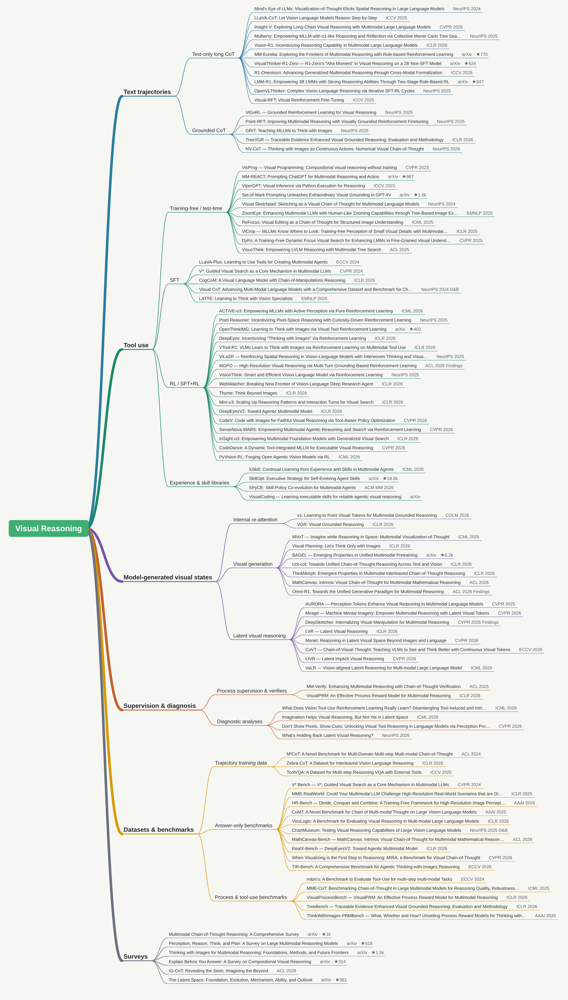

# Awesome Visual Reasoning

A curated list of visual reasoning papers with multi-step reasoning trajectories, organized by **task**, **reasoning mechanism**, and **adaptation**.

## Contents

- [Taxonomy](#taxonomy)
- [Visual Understanding & Reasoning](#visual-understanding--reasoning)
  - [Text Reasoning](#text-reasoning)
  - [Tool-assisted Reasoning](#tool-assisted-reasoning)
  - [Internal Visual Reasoning](#internal-visual-reasoning)
- [Visual Generation & Editing](#visual-generation--editing)
- [Unified Understanding & Generation](#unified-understanding--generation)
- [Agent Skills & Planning](#agent-skills--planning)
- [Supervision & Diagnosis](#supervision--diagnosis)
- [Datasets & Benchmarks](#datasets--benchmarks)
- [Surveys](#surveys)
- [Adding Papers](#adding-papers)

## Taxonomy

Use three independent axes to navigate this list. Section placement describes the task or contribution; the adaptation column describes how a method improves its capabilities.

| Axis | Categories | How to read it |
| --- | --- | --- |
| Task / contribution | Understanding & reasoning; generation & editing; unified models; agent skills & planning; supervision, analysis, and resources | What problem does the work address? |
| Reasoning mechanism | Text CoT; grounding; tool calls / executable code; internal re-attention; generated intermediate images; latent visual states | What carries the intermediate reasoning? |
| Adaptation | Parametric; non-parametric; hybrid; inference-only; unspecified | What changes when the method improves? |

**Adaptation labels** refer to the proposed method, relative to its starting models:

| Label | Meaning |
| --- | --- |
| **Parametric** | Updates model weights through pretraining, SFT, RL, preference optimization, or another training objective. |
| **Non-parametric** | Improves reusable external skills, code, memory, or experience without updating model weights. |
| **Hybrid** | Combines weight updates with non-parametric skill or memory updates. |
| **Inference-only** | Uses prompting, search, tool execution, or additional inference computation without method-specific weight updates or persistent skill learning. |
| **Unspecified** | The existing metadata does not establish whether weights or persistent external knowledge change. In particular, “test-time adaptation” alone is insufficient to decide. |

These labels describe adaptation, not architecture: inference-only and non-parametric methods can both use pretrained neural models. Tool use does not by itself imply non-parametric learning, and RL does not imply weight updates when the method explicitly operates on external experience.

**Generated images can serve different roles.** Here, [ThinkMorph](https://arxiv.org/abs/2510.27492) and [MathCanvas](https://arxiv.org/abs/2510.14958) sit under understanding because their images support reasoning. [Uni-CoT](https://arxiv.org/abs/2508.05606) and [Thinking with Generated Images](https://arxiv.org/abs/2505.22525) sit under generation because they evaluate image generation or editing. [Visual Planning](https://arxiv.org/abs/2505.11409) sits under planning because its image sequences encode plans. Placement is an editorial guide to the main contribution; capabilities can overlap across sections.

Adaptation labels are derived from the listed training metadata; ambiguous cases remain unspecified. This reorganization is not a full audit of every paper's training setup, venue, or release status. The figure above summarizes reasoning mechanisms; the sections below additionally organize papers by task and adaptation.

## Visual Understanding & Reasoning

Methods that answer questions, interpret visual evidence, or solve reasoning problems. Images may be inputs or intermediate thoughts; image synthesis need not be the final task.

### Text Reasoning

#### Text-only Long CoT

Reasoning trajectories expressed in text, including textual spatial representations.

| Paper | Date | Venue | Adaptation | Training / Optimization | Code |
| --- | --- | --- | --- | --- | --- |
| [CFPO: Counterfactual Policy Optimization for Multimodal Reasoning](https://arxiv.org/abs/2606.23206) | 2026-06 | ICML 2026 | Parametric | RL | [GitHub](https://github.com/Raven-July/CFPO)  |
| [From Seeing to Thinking: Decoupling Perception and Reasoning Improves Post-Training of Vision-Language Models](https://arxiv.org/abs/2605.20177) | 2026-05 | ICML 2026 | Parametric | RL | [GitHub](https://github.com/UCSC-VLAA/VLM-CapCurriculum)  |
| [Visually-Guided Policy Optimization for Multimodal Reasoning](https://arxiv.org/abs/2604.09349) | 2026-04 | ACL 2026 | Parametric | RL | [GitHub](https://github.com/wzb-bupt/VGPO)  |
| [From Narrow to Panoramic Vision: Attention-Guided Cold-Start Reshapes Multimodal Reasoning](https://arxiv.org/abs/2603.03825) | 2026-03 | ICLR 2026 | Parametric | SFT+RL | [GitHub](https://github.com/lrlbbzl/Qwen-AVAR)  |
| [DIVA-GRPO: Enhancing Multimodal Reasoning through Difficulty-Adaptive Variant Advantage](https://arxiv.org/abs/2603.01106) | 2026-03 | ICLR 2026 | Parametric | RL | [GitHub](https://github.com/Siaaaaaa1/DIVA-GRPO)  |
| [See Less, See Right: Bi-directional Perceptual Shaping For Multimodal Reasoning](https://arxiv.org/abs/2512.22120) | 2025-12 | CVPR 2026 | Parametric | RL | [GitHub](https://github.com/zss02/BiPS)  |
| [Stable and Efficient Single-Rollout RL for Multimodal Reasoning](https://arxiv.org/abs/2512.18215) | 2025-12 | CVPR 2026 | Parametric | RL | [GitHub](https://github.com/ruiiu/MSSR)  |
| [Perceptual-Evidence Anchored Reinforced Learning for Multimodal Reasoning](https://arxiv.org/abs/2511.18437) | 2025-11 | CVPR 2026 | Parametric | RL | [GitHub](https://github.com/MiliLab/PEARL)  |
| [OpenMMReasoner: Pushing the Frontiers for Multimodal Reasoning with an Open and General Recipe](https://arxiv.org/abs/2511.16334) | 2025-11 | CVPR 2026 | Parametric | SFT+RL | [GitHub](https://github.com/EvolvingLMMs-Lab/OpenMMReasoner)  |
| [Spotlight on Token Perception for Multimodal Reinforcement Learning](https://arxiv.org/abs/2510.09285) | 2025-10 | ICLR 2026 | Parametric | RL | [GitHub](https://github.com/huaixuheqing/VPPO-RL)  |
| [MM-HELIX: Boosting Multimodal Long-Chain Reflective Reasoning with Holistic Platform and Adaptive Hybrid Policy Optimization](https://arxiv.org/abs/2510.08540) | 2025-10 | ICLR 2026 | Parametric | SFT+RL | [GitHub](https://github.com/PhoenixZ810/MM-HELIX)  |
| [HoneyBee: Data Recipes for Vision-Language Reasoners](https://arxiv.org/abs/2510.12225) | 2025-10 | CVPR 2026 | Parametric | SFT | [GitHub](https://github.com/facebookresearch/HoneyBee_VLM)  |
| [Latent Chain-of-Thought for Visual Reasoning](https://arxiv.org/abs/2510.23925) | 2025-10 | NeurIPS 2025 | Parametric | RL | [GitHub](https://github.com/heliossun/LaCoT)  |
| [More Thought, Less Accuracy? On the Dual Nature of Reasoning in Vision-Language Models](https://arxiv.org/abs/2509.25848) | 2025-09 | ICLR 2026 | Parametric | RL | [GitHub](https://github.com/xytian1008/VAPO)  |
| [MMR1: Enhancing Multimodal Reasoning with Variance-Aware Sampling and Open Resources](https://arxiv.org/abs/2509.21268) | 2025-09 | CVPR 2026 Findings | Parametric | SFT+RL | [GitHub](https://github.com/LengSicong/MMR1)  |
| [Self-Rewarding Vision-Language Model via Reasoning Decomposition](https://arxiv.org/abs/2508.19652) | 2025-08 | ICLR 2026 | Parametric | RL | [GitHub](https://github.com/zli12321/Vision-SR1)  |
| [We-Math 2.0: A Versatile MathBook System for Incentivizing Visual Mathematical Reasoning](https://arxiv.org/abs/2508.10433) | 2025-08 | ICLR 2026 | Parametric | SFT+RL | [GitHub](https://github.com/We-Math/We-Math2.0)  |
| [Perception-Aware Policy Optimization for Multimodal Reasoning](https://arxiv.org/abs/2507.06448) | 2025-07 | ICLR 2026 | Parametric | RL | [GitHub](https://github.com/MikeWangWZHL/PAPO)  |
| [SRPO: Enhancing Multimodal LLM Reasoning via Reflection-Aware Reinforcement Learning](https://arxiv.org/abs/2506.01713) | 2025-06 | NeurIPS 2025 | Parametric | SFT+RL | [GitHub](https://github.com/SUSTechBruce/SRPO_MLLMs)  |
| [Advancing Multimodal Reasoning: From Optimized Cold Start to Staged Reinforcement Learning](https://arxiv.org/abs/2506.04207) | 2025-06 | ICLR 2026 | Parametric | SFT+RL | [GitHub](https://github.com/CSfufu/Revisual-R1)  |
| [Perception-R1: Advancing Multimodal Reasoning Capabilities of MLLMs via Visual Perception Reward](https://arxiv.org/abs/2506.07218) | 2025-06 | ICLR 2026 | Parametric | RL | [GitHub](https://github.com/tongxiao2002/Perception-R1)  |
| [VReST: Enhancing Reasoning in Large Vision-Language Models through Tree Search and Self-Reward Mechanism](https://arxiv.org/abs/2506.08691) | 2025-06 | ACL 2025 | Inference-only | Training-free | [GitHub](https://github.com/GaryJiajia/VReST)  |
| [GThinker: Towards General Multimodal Reasoning via Cue-Guided Rethinking](https://arxiv.org/abs/2506.01078) | 2025-06 | CVPR 2026 | Parametric | SFT+RL | [GitHub](https://github.com/jefferyZhan/GThinker)  |
| [R1-ShareVL: Incentivizing Reasoning Capability of Multimodal Large Language Models via Share-GRPO](https://arxiv.org/abs/2505.16673) | 2025-05 | NeurIPS 2025 | Parametric | RL | [GitHub](https://github.com/HJYao00/R1-ShareVL)  |
| [Visionary-R1: Mitigating Shortcuts in Visual Reasoning with Reinforcement Learning](https://arxiv.org/abs/2505.14677) | 2025-05 | TMLR | Parametric | RL | [GitHub](https://github.com/maifoundations/Visionary-R1)  |
| [VL-Rethinker: Incentivizing Self-Reflection of Vision-Language Models with Reinforcement Learning](https://arxiv.org/abs/2504.08837) | 2025-04 | NeurIPS 2025 | Parametric | RL | [GitHub](https://github.com/TIGER-AI-Lab/VL-Rethinker)  |
| [SFT or RL? An Early Investigation into Training R1-Like Reasoning Large Vision-Language Models](https://arxiv.org/abs/2504.11468) | 2025-04 | TMLR | Parametric | SFT / RL | [GitHub](https://github.com/UCSC-VLAA/VLAA-Thinking)  |
| [SoTA with Less: MCTS-Guided Sample Selection for Data-Efficient Visual Reasoning Self-Improvement](https://arxiv.org/abs/2504.07934) | 2025-04 | NeurIPS 2025 | Parametric | RL | [GitHub](https://github.com/si0wang/ThinkLite-VL)  |
| [NoisyRollout: Reinforcing Visual Reasoning with Data Augmentation](https://arxiv.org/abs/2504.13055) | 2025-04 | NeurIPS 2025 | Parametric | RL | [GitHub](https://github.com/WuWei-AI-Lab/NoisyRollout)  |
| [VLM-R1: A Stable and Generalizable R1-style Large Vision-Language Model](https://arxiv.org/abs/2504.07615) | 2025-04 | arXiv | Parametric | RL | [GitHub](https://github.com/om-ai-lab/VLM-R1)  |
| [Skywork R1V: Pioneering Multimodal Reasoning with Chain-of-Thought](https://arxiv.org/abs/2504.05599) | 2025-04 | arXiv | Parametric | SFT+RL | [GitHub](https://github.com/SkyworkAI/Skywork-R1V)  |
| [Vision-R1: Incentivizing Reasoning Capability in Multimodal Large Language Models](https://arxiv.org/abs/2503.06749) | 2025-03 | ICLR 2026 | Parametric | SFT+RL | [GitHub](https://github.com/Osilly/Vision-R1)  |
| [MM-Eureka: Exploring the Frontiers of Multimodal Reasoning with Rule-based Reinforcement Learning](https://arxiv.org/abs/2503.07365) | 2025-03 | arXiv | Parametric | RL | [GitHub](https://github.com/ModalMinds/MM-EUREKA)  |
| [R1-Zero's "Aha Moment" in Visual Reasoning on a 2B Non-SFT Model](https://arxiv.org/abs/2503.05132) | 2025-03 | arXiv | Parametric | RL | [GitHub](https://github.com/turningpoint-ai/VisualThinker-R1-Zero)  |
| [R1-Onevision: Advancing Generalized Multimodal Reasoning through Cross-Modal Formalization](https://arxiv.org/abs/2503.10615) | 2025-03 | ICCV 2025 | Parametric | SFT+RL | [GitHub](https://github.com/Fancy-MLLM/R1-onevision)  |
| [LMM-R1: Empowering 3B LMMs with Strong Reasoning Abilities Through Two-Stage Rule-Based RL](https://arxiv.org/abs/2503.07536) | 2025-03 | arXiv | Parametric | RL | [GitHub](https://github.com/TideDra/lmm-r1)  |
| [OpenVLThinker: Complex Vision-Language Reasoning via Iterative SFT-RL Cycles](https://arxiv.org/abs/2503.17352) | 2025-03 | NeurIPS 2025 | Parametric | SFT+RL | [GitHub](https://github.com/yihedeng9/OpenVLThinker)  |
| [Visual-RFT: Visual Reinforcement Fine-Tuning](https://arxiv.org/abs/2503.01785) | 2025-03 | ICCV 2025 | Parametric | RL | [GitHub](https://github.com/Liuziyu77/Visual-RFT)  |
| [R1-VL: Learning to Reason with Multimodal Large Language Models via Step-wise Group Relative Policy Optimization](https://arxiv.org/abs/2503.12937) | 2025-03 | ICCV 2025 | Parametric | RL | [GitHub](https://github.com/jingyi0000/R1-VL)  |
| [Reason-RFT: Reinforcement Fine-Tuning for Visual Reasoning of Vision Language Models](https://arxiv.org/abs/2503.20752) | 2025-03 | NeurIPS 2025 | Parametric | SFT+RL | [GitHub](https://github.com/tanhuajie/Reason-RFT)  |
| [Boosting the Generalization and Reasoning of Vision Language Models with Curriculum Reinforcement Learning](https://arxiv.org/abs/2503.07065) | 2025-03 | arXiv | Parametric | SFT+RL | [GitHub](https://github.com/ding523/Curr_REFT)  |
| [LlamaV-o1: Rethinking Step-by-step Visual Reasoning in LLMs](https://arxiv.org/abs/2501.06186) | 2025-01 | ACL 2025 Findings | Parametric | SFT | [GitHub](https://github.com/mbzuai-oryx/LlamaV-o1)  |
| [Virgo: A Preliminary Exploration on Reproducing o1-like MLLM](https://arxiv.org/abs/2501.01904) | 2025-01 | arXiv | Parametric | SFT | [GitHub](https://github.com/RUCAIBox/Virgo)  |
| [Mulberry: Empowering MLLM with o1-like Reasoning and Reflection via Collective Monte Carlo Tree Search](https://arxiv.org/abs/2412.18319) | 2024-12 | NeurIPS 2025 | Parametric | SFT | [GitHub](https://github.com/HJYao00/Mulberry)  |
| [MAmmoTH-VL: Eliciting Multimodal Reasoning with Instruction Tuning at Scale](https://arxiv.org/abs/2412.05237) | 2024-12 | ACL 2025 | Parametric | SFT | [GitHub](https://github.com/MAmmoTH-VL/MAmmoTH-VL)  |
| [LLaVA-CoT: Let Vision Language Models Reason Step-by-Step](https://arxiv.org/abs/2411.10440) | 2024-11 | ICCV 2025 | Parametric | SFT | [GitHub](https://github.com/PKU-YuanGroup/LLaVA-CoT)  |
| [Insight-V: Exploring Long-Chain Visual Reasoning with Multimodal Large Language Models](https://arxiv.org/abs/2411.14432) | 2024-11 | CVPR 2025 | Parametric | SFT+DPO | [GitHub](https://github.com/dongyh20/Insight-V)  |
| [Enhancing the Reasoning Ability of Multimodal Large Language Models via Mixed Preference Optimization](https://arxiv.org/abs/2411.10442) | 2024-11 | arXiv | Parametric | MPO | [GitHub](https://github.com/OpenGVLab/InternVL)  |
| [Improve Vision Language Model Chain-of-thought Reasoning](https://arxiv.org/abs/2410.16198) | 2024-10 | ACL 2025 | Parametric | SFT+DPO | [GitHub](https://github.com/RifleZhang/LLaVA-Reasoner-DPO)  |
| [Vision-Language Models Can Self-Improve Reasoning via Reflection](https://arxiv.org/abs/2411.00855) | 2024-10 | NAACL 2025 | Parametric | SFT | [GitHub](https://github.com/njucckevin/MM-Self-Improve)  |
| [Mind's Eye of LLMs: Visualization-of-Thought Elicits Spatial Reasoning in Large Language Models](https://arxiv.org/abs/2404.03622) | 2024-04 | NeurIPS 2024 | Inference-only | Training-free | [GitHub](https://github.com/microsoft/visualization-of-thought)  |
| [DDCoT: Duty-Distinct Chain-of-Thought Prompting for Multimodal Reasoning in Language Models](https://arxiv.org/abs/2310.16436) | 2023-10 | NeurIPS 2023 | Inference-only | Training-free | [GitHub](https://github.com/SooLab/DDCOT)  |
| [T-SciQ: Teaching Multimodal Chain-of-Thought Reasoning via Mixed Large Language Model Signals for Science Question Answering](https://arxiv.org/abs/2305.03453) | 2023-05 | AAAI 2024 | Parametric | SFT | [GitHub](https://github.com/T-SciQ/T-SciQ)  |
| [Multimodal Chain-of-Thought Reasoning in Language Models](https://arxiv.org/abs/2302.00923) | 2023-02 | TMLR | Parametric | SFT | [GitHub](https://github.com/amazon-science/mm-cot)  |

More papers without released code (8)

| Paper | Date | Venue | Adaptation | Training / Optimization | Code |
| --- | --- | --- | --- | --- | --- |
| [RECAP: Looking Once Is Not Enough for Vision-Language Reasoning](https://arxiv.org/abs/2610.30834) | 2026-10 | NeurIPS 2026 | Parametric | RL | — |
| [Local Evidence, Global Credit: Visual Evidence-Calibrated Policy Optimization for Multimodal Reasoning](https://aclanthology.org/2026.findings-emnlp.1818/) | 2026 | EMNLP 2026 Findings | Parametric | RL | — |
| [Do MLLMs Really See It: Reinforcing Visual Attention in Multimodal LLMs](https://arxiv.org/abs/2602.08241) | 2026-02 | EMNLP 2026 | Parametric | RL | — |
| [VOLD: Reasoning Transfer from LLMs to Vision-Language Models via On-Policy Distillation](https://arxiv.org/abs/2510.23497) | 2025-10 | CVPR 2026 | Parametric | SFT+RL | [GitHub](https://github.com/WalBouss/VOLD)  (code pending) |
| [Open Vision Reasoner: Transferring Linguistic Cognitive Behavior for Visual Reasoning](https://arxiv.org/abs/2507.05255) | 2025-07 | NeurIPS 2025 | Parametric | SFT+RL | — |
| [SyncLoop: A Multimodal Dual-Loop Framework for Self-Improving Mathematical Reasoning](https://arxiv.org/abs/2507.16518) | 2025-07 | ECCV 2026 | Parametric | SFT+RL | [GitHub](https://github.com/chen-xw/C2-Evo)  (code pending) |
| [AStar: Boosting Multimodal Reasoning with Automated Structured Thinking](https://arxiv.org/abs/2502.02339) | 2025-02 | AAAI 2026 | Inference-only | Training-free | — |
| [Diving into Self-Evolving Training for Multimodal Reasoning](https://arxiv.org/abs/2412.17451) | 2024-12 | ICML 2025 | Parametric | SFT | [GitHub](https://github.com/hkust-nlp/mstar)  (code pending) |

#### Grounded CoT

Textual reasoning tied to explicit visual evidence, points, regions, or coordinates.

| Paper | Date | Venue | Adaptation | Training / Optimization | Code |
| --- | --- | --- | --- | --- | --- |
| [Thinking with Visual Grounding](https://arxiv.org/abs/2606.16122) | 2026-06 | EMNLP 2026 Findings | Parametric | SFT+RL | [GitHub](https://github.com/Jun-Kai-Zhang/visually_grounded_thinking)  |
| [iVGR: Internalizing Visually Grounded Reasoning for MLLMs with Reinforcement Learning](https://arxiv.org/abs/2605.31096) | 2026-05 | ICML 2026 | Parametric | RL | [GitHub](https://github.com/Visual-AI/ivgr)  |
| [Thinking with Images as Continuous Actions: Numerical Visual Chain-of-Thought](https://arxiv.org/abs/2602.23959) | 2026-02 | NeurIPS 2026 | Parametric | SFT+RL | [GitHub](https://github.com/kesenzhao/NV-CoT)  |
| [RegionReasoner: Region-Grounded Multi-Round Visual Reasoning](https://arxiv.org/abs/2602.03733) | 2026-02 | ICLR 2026 | Parametric | RL | [GitHub](https://github.com/lmsdss/RegionReasoner)  |
| [Mixture-of-Visual-Thoughts: Exploring Context-Adaptive Reasoning Mode Selection for General Visual Reasoning](https://arxiv.org/abs/2509.22746) | 2025-09 | ICLR 2026 | Parametric | SFT+RL | [GitHub](https://github.com/Future-Living-Lab/mixture-of-visual-thoughts)  |
| [DeFacto: Counterfactual Thinking with Images for Enforcing Evidence-Grounded and Faithful Reasoning](https://arxiv.org/abs/2509.20912) | 2025-09 | ICML 2026 | Parametric | RL | [GitHub](https://github.com/tinnel123666888/defacto)  |
| [SIFThinker: Spatially-Aware Image Focus for Visual Reasoning](https://arxiv.org/abs/2508.06259) | 2025-08 | AAAI 2026 | Parametric | SFT+RL | [GitHub](https://github.com/bytedance/SIFThinker)  |
| [Traceable Evidence Enhanced Visual Grounded Reasoning: Evaluation and Methodology](https://arxiv.org/abs/2507.07999) | 2025-07 | ICLR 2026 | Parametric | RL | [GitHub](https://github.com/Haochen-Wang409/TreeVGR)  |
| [Rex-Thinker: Grounded Object Referring via Chain-of-Thought Reasoning](https://arxiv.org/abs/2506.04034) | 2025-06 | ICLR 2026 | Parametric | SFT+RL | [GitHub](https://github.com/IDEA-Research/Rex-Thinker)  |
| [Grounded Reinforcement Learning for Visual Reasoning](https://arxiv.org/abs/2505.23678) | 2025-05 | NeurIPS 2025 | Parametric | SFT+RL | [GitHub](https://github.com/Gabesarch/grounded-rl)  |
| [GRIT: Teaching MLLMs to Think with Images](https://arxiv.org/abs/2505.15879) | 2025-05 | NeurIPS 2025 | Parametric | RL | [GitHub](https://github.com/eric-ai-lab/GRIT)  |
| [Argus: Vision-Centric Reasoning with Grounded Chain-of-Thought](https://arxiv.org/abs/2505.23766) | 2025-05 | CVPR 2025 | Parametric | SFT | — (highly cited) |
| [Grounded Chain-of-Thought for Multimodal Large Language Models](https://arxiv.org/abs/2503.12799) | 2025-03 | CVPR 2026 | Parametric | SFT | [GitHub](https://github.com/DoubtedSteam/MM-GCoT)  |
| [VoCoT: Unleashing Visually Grounded Multi-Step Reasoning in Large Multi-Modal Models](https://arxiv.org/abs/2405.16919) | 2024-05 | NAACL 2025 | Parametric | SFT | [GitHub](https://github.com/RupertLuo/VoCoT)  |
| [Compositional Chain-of-Thought Prompting for Large Multimodal Models](https://arxiv.org/abs/2311.17076) | 2023-11 | CVPR 2024 | Inference-only | Training-free | [GitHub](https://github.com/chancharikmitra/CCoT)  |
| [Shikra: Unleashing Multimodal LLM's Referential Dialogue Magic](https://arxiv.org/abs/2306.15195) | 2023-06 | arXiv | Parametric | SFT | [GitHub](https://github.com/shikras/shikra)  |

More papers without released code (2)

| Paper | Date | Venue | Adaptation | Training / Optimization | Code |
| --- | --- | --- | --- | --- | --- |
| [Thinking with Visual Primitives](https://neurips.cc/virtual/2026/poster/154630) | 2026 | NeurIPS 2026 | Unspecified | Not stated | — |
| [Point-RFT: Improving Multimodal Reasoning with Visually Grounded Reinforcement Finetuning](https://arxiv.org/abs/2505.19702) | 2025-05 | NeurIPS 2025 | Parametric | SFT+RL | — |

### Tool-assisted Reasoning

Methods that inspect or manipulate visual evidence through external tools. Grouped by adaptation; the training column retains the specific optimization recipe.

#### Inference-only & Test-time Methods

Prompting, visual search, code execution, and tool orchestration. Entries labeled test-time adaptation retain an unspecified adaptation label until their update mechanism is established.

| Paper | Date | Venue | Adaptation | Training / Optimization | Code |
| --- | --- | --- | --- | --- | --- |
| [SpatialClaw: Rethinking Action Interface for Agentic Spatial Reasoning](https://arxiv.org/abs/2606.13673) | 2026-06 | NeurIPS 2026 | Inference-only | Training-free | [GitHub](https://github.com/NVlabs/SpatialClaw)  |
| [VTOS: Learning to Orchestrate Vision Tools by Co-Searching Solutions and Observers](https://arxiv.org/abs/2606.20728) | 2026-06 | EMNLP 2026 | Inference-only | Training-free | [GitHub](https://github.com/jinchaogjc/VTOS)  |
| [CVSearch: Empowering Multimodal LLMs with Cognitive Visual Search for High-Resolution Image Perception](https://arxiv.org/abs/2605.23655) | 2026-05 | ICML 2026 | Inference-only | Training-free | [GitHub](https://github.com/liliupeng28/ICML26-CVSearch)  |
| [The Perceptual Bandwidth Bottleneck in Vision-Language Models: Active Visual Reasoning via Sequential Experimental Design](https://arxiv.org/abs/2605.01345) | 2026-05 | ICML 2026 | Inference-only | Training-free | [GitHub](https://github.com/iamlilAJ/active-vlm)  |
| [Entropy-Gradient Grounding: Training-Free Evidence Retrieval in Vision-Language Models](https://arxiv.org/abs/2604.08456) | 2026-04 | ECCV 2026 | Inference-only | Training-free | [GitHub](https://github.com/merci00001/entropy-gradient-grounding)  |
| [SpatiO: Adaptive Test-Time Orchestration of Vision-Language Agents for Spatial Reasoning](https://arxiv.org/abs/2604.21190) | 2026-04 | ECCV 2026 | Inference-only | Training-free | [GitHub](https://github.com/CY-H1329/SpatiO)  |
| [SpecEyes: Accelerating Agentic Multimodal LLMs via Speculative Perception and Planning](https://arxiv.org/abs/2603.23483) | 2026-03 | ECCV 2026 | Inference-only | Training-free | [GitHub](https://github.com/MAC-AutoML/SpecEyes)  |
| [Graph-of-Mark: Promote Spatial Reasoning in Multimodal Language Models with Graph-Based Visual Prompting](https://arxiv.org/abs/2603.06663) | 2026-03 | AAAI 2026 | Inference-only | Training-free | [GitHub](https://github.com/disi-unibo-nlp/graph-of-marks)  |
| [Reliable Thinking with Images](https://arxiv.org/abs/2602.12916) | 2026-02 | ICML 2026 | Inference-only | Training-free | [GitHub](https://github.com/XLearning-SCU/Reliable_TWI)  |
| [Geometrically-Constrained Agent for Spatial Reasoning](https://arxiv.org/abs/2511.22659) | 2025-11 | CVPR 2026 | Inference-only | Training-free | [GitHub](https://github.com/gca-spatial-reasoning/gca)  |
| [PixelCraft: A Multi-Agent System for High-Fidelity Visual Reasoning on Structured Images](https://arxiv.org/abs/2509.25185) | 2025-09 | ICLR 2026 | Inference-only | Training-free | [GitHub](https://github.com/microsoft/PixelCraft)  |
| [HiDe: Rethinking The Zoom-IN method in High Resolution MLLMs via Hierarchical Decoupling](https://arxiv.org/abs/2510.00054) | 2025-09 | ICML 2026 | Inference-only | Training-free | [GitHub](https://github.com/Tennine2077/HiDe)  |
| [PyVision: Agentic Vision with Dynamic Tooling](https://arxiv.org/abs/2507.07998) | 2025-07 | NeurIPS 2025 Workshop | Inference-only | Training-free | [GitHub](https://github.com/agents-x-project/PyVision)  |
| [Thinking with Visual Abstract: Enhancing Multimodal Reasoning via Visual Abstraction](https://arxiv.org/abs/2505.20164) | 2025-05 | NeurIPS 2025 Workshop | Inference-only | Training-free | [GitHub](https://github.com/THUNLP-MT/VAT)  |
| [DyFo: A Training-Free Dynamic Focus Visual Search for Enhancing LMMs in Fine-Grained Visual Understanding](https://arxiv.org/abs/2504.14920) | 2025-04 | CVPR 2025 | Unspecified | Test-time adaptation | [GitHub](https://github.com/PKU-ICST-MIPL/DyFo_CVPR2025)  |
| [VisuoThink: Empowering LVLM Reasoning with Multimodal Tree Search](https://arxiv.org/abs/2504.09130) | 2025-04 | ACL 2025 | Unspecified | Test-time adaptation | [GitHub](https://github.com/ekonwang/VisuoThink)  |
| [Perspective-Aware Reasoning in Vision-Language Models via Mental Imagery Simulation](https://arxiv.org/abs/2504.17207) | 2025-04 | ICCV 2025 | Inference-only | Training-free | [GitHub](https://github.com/KAIST-Visual-AI-Group/APC-VLM)  |
| [Retrieval-Augmented Perception: High-Resolution Image Perception Meets Visual RAG](https://arxiv.org/abs/2503.01222) | 2025-03 | ICML 2025 | Inference-only | Training-free | [GitHub](https://github.com/DreamMr/RAP)  |
| [Through the Magnifying Glass: Adaptive Perception Magnification for Hallucination-Free VLM Decoding](https://arxiv.org/abs/2503.10183) | 2025-03 | ACL 2026 | Inference-only | Training-free | [GitHub](https://github.com/ShunqiM/PM)  |
| [MLLMs Know Where to Look: Training-free Perception of Small Visual Details with Multimodal LLMs](https://arxiv.org/abs/2502.17422) | 2025-02 | ICLR 2025 | Inference-only | Training-free | [GitHub](https://github.com/saccharomycetes/mllms_know)  |
| [OctoTools: An Agentic Framework with Extensible Tools for Complex Reasoning](https://arxiv.org/abs/2502.11271) | 2025-02 | ACL 2026 | Inference-only | Training-free | [GitHub](https://github.com/octotools/octotools)  |
| [NAVER: A Neuro-Symbolic Compositional Automaton for Visual Grounding with Explicit Logic Reasoning](https://arxiv.org/abs/2502.00372) | 2025-02 | ICCV 2025 | Inference-only | Training-free | [GitHub](https://github.com/ControlNet/NAVER)  |
| [ReFocus: Visual Editing as a Chain of Thought for Structured Image Understanding](https://arxiv.org/abs/2501.05452) | 2025-01 | ICML 2025 | Inference-only | Training-free | [GitHub](https://github.com/zeyofu/ReFocus_Code)  |
| [ViUniT: Visual Unit Tests for More Robust Visual Programming](https://arxiv.org/abs/2412.08859) | 2024-12 | CVPR 2025 | Inference-only | Training-free | [GitHub](https://github.com/SalesforceAIResearch/visual-unit-testing)  |
| [ZoomEye: Enhancing Multimodal LLMs with Human-Like Zooming Capabilities through Tree-Based Image Exploration](https://arxiv.org/abs/2411.16044) | 2024-11 | EMNLP 2025 | Unspecified | Test-time adaptation | [GitHub](https://github.com/om-ai-lab/ZoomEye)  |
| [Visual Sketchpad: Sketching as a Visual Chain of Thought for Multimodal Language Models](https://arxiv.org/abs/2406.09403) | 2024-06 | NeurIPS 2024 | Inference-only | Training-free | [GitHub](https://github.com/Yushi-Hu/VisualSketchpad)  |
| [Image-of-Thought Prompting for Visual Reasoning Refinement in Multimodal Large Language Models](https://arxiv.org/abs/2405.13872) | 2024-05 | arXiv | Inference-only | Training-free | — (highly cited) |
| [Cantor: Inspiring Multimodal Chain-of-Thought of MLLM](https://arxiv.org/abs/2404.16033) | 2024-04 | ACM MM 2024 | Inference-only | Training-free | [GitHub](https://github.com/ggg0919/cantor)  |
| [HYDRA: A Hyper Agent for Dynamic Compositional Visual Reasoning](https://arxiv.org/abs/2403.12884) | 2024-03 | ECCV 2024 | Inference-only | Training-free | [GitHub](https://github.com/ControlNet/HYDRA)  |
| [DetToolChain: A New Prompting Paradigm to Unleash Detection Ability of MLLM](https://arxiv.org/abs/2403.12488) | 2024-03 | ECCV 2024 | Inference-only | Training-free | — (highly cited) |
| [SpatialPIN: Enhancing Spatial Reasoning Capabilities of Vision-Language Models through Prompting and Interacting 3D Priors](https://arxiv.org/abs/2403.13438) | 2024-03 | NeurIPS 2024 | Inference-only | Training-free | [GitHub](https://github.com/dannymcy/zeroshot_task_hallucination_code)  |
| [Scaffolding Coordinates to Promote Vision-Language Coordination in Large Multi-Modal Models](https://arxiv.org/abs/2402.12058) | 2024-02 | COLING 2025 | Inference-only | Training-free | [GitHub](https://github.com/THUNLP-MT/Scaffold)  |
| [Recursive Visual Programming](https://arxiv.org/abs/2312.02249) | 2023-12 | ECCV 2024 | Inference-only | Training-free | [GitHub](https://github.com/para-lost/RVP)  |
| [Set-of-Mark Prompting Unleashes Extraordinary Visual Grounding in GPT-4V](https://arxiv.org/abs/2310.11441) | 2023-10 | arXiv | Inference-only | Training-free | [GitHub](https://github.com/microsoft/SoM)  |
| [Large Language Models are Visual Reasoning Coordinators](https://arxiv.org/abs/2310.15166) | 2023-10 | NeurIPS 2023 | Inference-only | Training-free | [GitHub](https://github.com/cliangyu/Cola)  |
| [Modular Visual Question Answering via Code Generation](https://arxiv.org/abs/2306.05392) | 2023-06 | ACL 2023 | Inference-only | Training-free | [GitHub](https://github.com/sanjayss34/codevqa)  |
| [AssistGPT: A General Multi-modal Assistant that can Plan, Execute, Inspect, and Learn](https://arxiv.org/abs/2306.08640) | 2023-06 | arXiv | Inference-only | Training-free | [GitHub](https://github.com/showlab/assistgpt)  (code pending) |
| [InternGPT: Solving Vision-Centric Tasks by Interacting with ChatGPT Beyond Language](https://arxiv.org/abs/2305.05662) | 2023-05 | arXiv | Inference-only | Training-free | [GitHub](https://github.com/OpenGVLab/InternGPT)  |
| [IdealGPT: Iteratively Decomposing Vision and Language Reasoning via Large Language Models](https://arxiv.org/abs/2305.14985) | 2023-05 | EMNLP 2023 Findings | Inference-only | Training-free | [GitHub](https://github.com/Hxyou/IdealGPT)  |
| [Chameleon: Plug-and-Play Compositional Reasoning with Large Language Models](https://arxiv.org/abs/2304.09842) | 2023-04 | NeurIPS 2023 | Inference-only | Training-free | [GitHub](https://github.com/lupantech/chameleon-llm)  |
| [MM-REACT: Prompting ChatGPT for Multimodal Reasoning and Action](https://arxiv.org/abs/2303.11381) | 2023-03 | arXiv | Inference-only | Training-free | [GitHub](https://github.com/microsoft/MM-REACT)  |
| [ViperGPT: Visual Inference via Python Execution for Reasoning](https://arxiv.org/abs/2303.08128) | 2023-03 | ICCV 2023 | Inference-only | Training-free | [GitHub](https://github.com/cvlab-columbia/viper)  |
| [HuggingGPT: Solving AI Tasks with ChatGPT and its Friends in Hugging Face](https://arxiv.org/abs/2303.17580) | 2023-03 | NeurIPS 2023 | Inference-only | Training-free | [GitHub](https://github.com/microsoft/JARVIS)  |
| [Visual ChatGPT: Talking, Drawing and Editing with Visual Foundation Models](https://arxiv.org/abs/2303.04671) | 2023-03 | arXiv | Inference-only | Training-free | [GitHub](https://github.com/chenfei-wu/TaskMatrix)  |
| [Visual Programming: Compositional visual reasoning without training](https://arxiv.org/abs/2211.11559) | 2022-11 | CVPR 2023 | Inference-only | Training-free | [GitHub](https://github.com/allenai/visprog)  |

More papers without released code (16)

| Paper | Date | Venue | Adaptation | Training / Optimization | Code |
| --- | --- | --- | --- | --- | --- |
| [Towards High-Resolution Visual Perception via Hierarchical Entity Exploration](https://arxiv.org/abs/2607.00816) | 2026-07 | ECCV 2026 | Inference-only | Training-free | — |
| [Self-Prophetic Decoding to Unlock Visual Search in LVLMs](https://arxiv.org/abs/2605.28741) | 2026-05 | ICML 2026 | Inference-only | Training-free | — |
| [Hierarchical Visual Agent: Managing Contexts in Joint Image-Text Space for Advanced Chart Reasoning](https://arxiv.org/abs/2605.04304) | 2026-05 | ACL 2026 Findings | Inference-only | Training-free | — |
| [Seeing Before Agreeing: Aligning Multi-Agent Consensus with Visual Evidence](https://arxiv.org/abs/2605.30698) | 2026-05 | EMNLP 2026 Findings | Inference-only | Training-free | — |
| [DeepScan: A Training-Free Framework for Visually Grounded Reasoning in Large Vision-Language Models](https://arxiv.org/abs/2603.03857) | 2026-03 | CVPR 2026 | Inference-only | Training-free | — |
| [Visual Prompt Discovery via Semantic Exploration](https://arxiv.org/abs/2603.16250) | 2026-03 | ECCV 2026 | Inference-only | Training-free | — |
| [See It, Say It, Sorted: An Iterative Training-Free Framework for Visually-Grounded Multimodal Reasoning in LVLMs](https://arxiv.org/abs/2602.21497) | 2026-02 | CVPR 2026 | Inference-only | Training-free | — |
| [MRD: Multi-resolution Retrieval-Detection Fusion for High-Resolution Image Understanding](https://arxiv.org/abs/2512.02906) | 2025-12 | CVPR 2026 | Inference-only | Training-free | [GitHub](https://github.com/yf0412/MRD)  (code pending) |
| [Visual Funnel: Resolving Contextual Blindness in Multimodal Large Language Models](https://arxiv.org/abs/2512.10362) | 2025-12 | CVPR 2026 Findings | Inference-only | Training-free | — |
| [ChartAgent: A Multimodal Agent for Visually Grounded Reasoning in Complex Chart Question Answering](https://arxiv.org/abs/2510.04514) | 2025-10 | ACL 2026 | Inference-only | Training-free | — |
| [ToolScope: An Agentic Framework for Vision-Guided and Long-Horizon Tool Use](https://arxiv.org/abs/2510.27363) | 2025-10 | ACL 2026 Findings | Inference-only | Training-free | — |
| [FOCUS: Internal MLLM Representations for Efficient Fine-Grained Visual Question Answering](https://arxiv.org/abs/2506.21710) | 2025-06 | NeurIPS 2025 | Inference-only | Training-free | — |
| [VipAct: Visual-Perception Enhancement via Specialized VLM Agent Collaboration and Tool-use](https://arxiv.org/abs/2410.16400) | 2024-10 | AAAI 2026 | Inference-only | Training-free | — |
| [Whiteboard-of-Thought: Thinking Step-by-Step Across Modalities](https://arxiv.org/abs/2406.14562) | 2024-06 | EMNLP 2024 | Inference-only | Training-free | — |
| [De-fine: Decomposing and Refining Visual Programs with Auto-Feedback](https://arxiv.org/abs/2311.12890) | 2023-11 | ACM MM 2024 | Inference-only | Training-free | — |
| [AVIS: Autonomous Visual Information Seeking with Large Language Model Agent](https://arxiv.org/abs/2306.08129) | 2023-06 | NeurIPS 2023 | Inference-only | Training-free | — |

#### Parametric Tool Use — SFT

Tool use learned through supervised fine-tuning.

| Paper | Date | Venue | Adaptation | Training / Optimization | Code |
| --- | --- | --- | --- | --- | --- |
| [Proof-of-Perception: Certified Tool-Using Multimodal Reasoning with Compositional Conformal Guarantees](https://arxiv.org/abs/2603.00324) | 2026-02 | CVPR 2026 | Parametric | SFT | [GitHub](https://github.com/AryaFayyazi/PoP)  |
| [MATA: A Trainable Hierarchical Automaton System for Multi-Agent Visual Reasoning](https://arxiv.org/abs/2601.19204) | 2026-01 | ICLR 2026 | Parametric | SFT | [GitHub](https://github.com/ControlNet/MATA)  |
| [Skywork-R1V4: Toward Agentic Multimodal Intelligence through Interleaved Thinking with Images and DeepResearch](https://arxiv.org/abs/2512.02395) | 2025-12 | arXiv | Parametric | SFT | [GitHub](https://github.com/SkyworkAI/Skywork-R1V)  |
| [CodePlot-CoT: Mathematical Visual Reasoning by Thinking with Code-Driven Images](https://arxiv.org/abs/2510.11718) | 2025-10 | CVPR 2026 Findings | Parametric | SFT | [GitHub](https://github.com/HKU-MMLab/Math-VR-CodePlot-CoT)  |
| [Unsupervised Visual Chain-of-Thought Reasoning via Preference Optimization](https://arxiv.org/abs/2504.18397) | 2025-04 | ICCV 2025 | Parametric | DPO | [GitHub](https://github.com/kesenzhao/UV-CoT)  |
| [Iterative Tool Usage Exploration for Multimodal Agents via Step-wise Preference Tuning](https://arxiv.org/abs/2504.21561) | 2025-04 | NeurIPS 2025 | Parametric | Preference tuning | [GitHub](https://github.com/SPORT-Agents/SPORT-Agents)  |
| [DWIM: Towards Tool-aware Visual Reasoning via Discrepancy-aware Workflow Generation & Instruct-Masking Tuning](https://arxiv.org/abs/2503.19263) | 2025-03 | ICCV 2025 | Parametric | SFT | [GitHub](https://github.com/pokerme7777/DWIM)  |
| [VisRL: Intention-Driven Visual Perception via Reinforced Reasoning](https://arxiv.org/abs/2503.07523) | 2025-03 | ICCV 2025 | Parametric | SFT+DPO | [GitHub](https://github.com/zhangquanchen/VisRL)  |
| [LATTE: Learning to Think with Vision Specialists](https://arxiv.org/abs/2412.05479) | 2024-12 | EMNLP 2025 | Parametric | SFT | [GitHub](https://github.com/SalesforceAIResearch/LATTE)  |
| [Multi-modal Agent Tuning: Building a VLM-Driven Agent for Efficient Tool Usage](https://arxiv.org/abs/2412.15606) | 2024-12 | ICLR 2025 | Parametric | SFT | [GitHub](https://github.com/mat-agent/MAT-Agent)  |
| [Visual Agents as Fast and Slow Thinkers](https://arxiv.org/abs/2408.08862) | 2024-08 | ICLR 2025 | Parametric | SFT | [GitHub](https://github.com/GuangyanS/Sys2-LLaVA)  |
| [From the Least to the Most: Building a Plug-and-Play Visual Reasoner via Data Synthesis](https://arxiv.org/abs/2406.19934) | 2024-06 | EMNLP 2024 | Parametric | SFT | [GitHub](https://github.com/steven-ccq/VisualReasoner)  |
| [VDebugger: Harnessing Execution Feedback for Debugging Visual Programs](https://arxiv.org/abs/2406.13444) | 2024-06 | EMNLP 2024 Findings | Parametric | SFT | [GitHub](https://github.com/shirley-wu/vdebugger)  |
| [Visual CoT: Advancing Multi-Modal Language Models with a Comprehensive Dataset and Benchmark for Chain-of-Thought Reasoning](https://arxiv.org/abs/2403.16999) | 2024-03 | NeurIPS 2024 D&B | Parametric | SFT | [GitHub](https://github.com/deepcs233/Visual-CoT)  |
| [Chain-of-Spot: Interactive Reasoning Improves Large Vision-Language Models](https://arxiv.org/abs/2403.12966) | 2024-03 | arXiv | Parametric | SFT | [GitHub](https://github.com/dongyh20/Chain-of-Spot)  |
| [CogCoM: A Visual Language Model with Chain-of-Manipulations Reasoning](https://arxiv.org/abs/2402.04236) | 2024-02 | ICLR 2025 | Parametric | SFT | [GitHub](https://github.com/THUDM/CogCoM)  |
| [MLLM-Tool: A Multimodal Large Language Model For Tool Agent Learning](https://arxiv.org/abs/2401.10727) | 2024-01 | WACV 2025 | Parametric | SFT | [GitHub](https://github.com/Chenyu-Wang567/MLLM-Tool)  |
| [V\*: Guided Visual Search as a Core Mechanism in Multimodal LLMs](https://arxiv.org/abs/2312.14135) | 2023-12 | CVPR 2024 | Parametric | SFT | [GitHub](https://github.com/penghao-wu/vstar)  |
| [Visual Program Distillation: Distilling Tools and Programmatic Reasoning into Vision-Language Models](https://arxiv.org/abs/2312.03052) | 2023-12 | CVPR 2024 | Parametric | SFT | — (highly cited) |
| [LLaVA-Plus: Learning to Use Tools for Creating Multimodal Agents](https://arxiv.org/abs/2311.05437) | 2023-11 | ECCV 2024 | Parametric | SFT | [GitHub](https://github.com/LLaVA-VL/LLaVA-Plus-Codebase)  |
| [GPT4Tools: Teaching Large Language Model to Use Tools via Self-instruction](https://arxiv.org/abs/2305.18752) | 2023-05 | NeurIPS 2023 | Parametric | SFT | [GitHub](https://github.com/AILab-CVC/GPT4Tools)  |

More papers without released code (5)

| Paper | Date | Venue | Adaptation | Training / Optimization | Code |
| --- | --- | --- | --- | --- | --- |
| [LogT: Logically Think with Images for Visual Search](https://arxiv.org/abs/2611.19200) | 2026-11 | NeurIPS 2026 | Parametric | SFT | — |
| [Bridging Modality Disconnect in Self-Reflection via Closed-Loop Visually Grounded Verification](https://arxiv.org/abs/2602.18746) | 2026-02 | EMNLP 2026 | Parametric | SFT | — |
| [SPARC: Separating Perception And Reasoning Circuits for Test-time Scaling of VLMs](https://arxiv.org/abs/2602.06566) | 2026-02 | ICML 2026 | Parametric | SFT | — |
| [Simple o3: Towards Interleaved Vision-Language Reasoning](https://arxiv.org/abs/2508.12109) | 2025-08 | ACL 2026 | Parametric | SFT | — |
| [Visual Program Distillation with Template-Based Augmentation](https://arxiv.org/abs/2412.08564) | 2024-12 | EMNLP 2025 Findings | Parametric | Distillation | [GitHub](https://github.com/michalsr/vp_distill_templates)  (code pending) |

#### Parametric Tool Use — RL & Combined Training

Tool policies optimized with reinforcement learning, sometimes alongside supervised fine-tuning.

| Paper | Date | Venue | Adaptation | Training / Optimization | Code |
| --- | --- | --- | --- | --- | --- |
| [Learning Where to Look: Observation Policy Optimization for Thinking with Images](https://arxiv.org/abs/2611.04943) | 2026-11 | NeurIPS 2026 | Parametric | RL | [GitHub](https://github.com/Yann0122/Observation-Policy-Optimization)  |
| [Learning to Zoom Efficiently with a Contrastive Curriculum](https://arxiv.org/abs/2609.03206) | 2026-09 | EMNLP 2026 | Parametric | RL | [GitHub](https://github.com/UKPLab/emnlp2026-zoom-in)  |
| [Beacon: Knowing When and How to Perform Agentic Visual Reasoning](https://arxiv.org/abs/2607.28595) | 2026-07 | arXiv | Parametric | RL | [GitHub](https://github.com/NOVAglow646/Beacon)  |
| [Perceive, Interact, Reason: Building Tool-Augmented Visual Agents for Spatial Reasoning](https://arxiv.org/abs/2606.12830) | 2026-06 | NeurIPS 2026 | Parametric | SFT+RL | [GitHub](https://github.com/antoinegg1/PEDIA)  |
| [Active Exploring like a Pigeon: Reinforcing Spatial Reasoning via Agentic Vision-Language Models](https://arxiv.org/abs/2606.02459) | 2026-06 | ICML 2026 | Parametric | SFT+RL | [GitHub](https://github.com/dw-dengwei/active-spatial-reasoning)  |
| [ProMSA: Progressive Multimodal Search Agents for Knowledge-Based Visual Question Answering](https://arxiv.org/abs/2606.27974) | 2026-06 | ECCV 2026 | Parametric | SFT+RL | [GitHub](https://github.com/DingWu1021/Promsa)  |
| [OpenSearch-VL: An Open Recipe for Frontier Multimodal Search Agents](https://arxiv.org/abs/2605.05185) | 2026-05 | NeurIPS 2026 | Parametric | SFT+RL | [GitHub](https://github.com/shawn0728/OpenSearch-VL)  |
| [Vision-OPD: Learning to See Fine Details for Multimodal LLMs via On-Policy Self-Distillation](https://arxiv.org/abs/2605.18740) | 2026-05 | NeurIPS 2026 | Parametric | On-policy distillation | [GitHub](https://github.com/VisionOPD/Vision-OPD)  |
| [Train the Agent, Not the Expert: Learning to Harness Heterogeneous Experts for Multi-Turn Visual Reasoning](https://arxiv.org/abs/2605.29894) | 2026-05 | NeurIPS 2026 | Parametric | SFT+RL | [GitHub](https://github.com/fyw1999/VisHarness)  |
| [Towards On-Policy Data Evolution for Visual-Native Multimodal Deep Search Agents](https://arxiv.org/abs/2605.10832) | 2026-05 | NeurIPS 2026 | Parametric | SFT+RL | [GitHub](https://github.com/JoeYing1019/ODE)  |
| [Waking Up Blind: Cold-Start Optimization of Supervision-Free Agentic Trajectories for Grounded Visual Perception](https://arxiv.org/abs/2604.17475) | 2026-04 | ACL 2026 Findings | Parametric | RL | [GitHub](https://github.com/ab-iitd/spectra)  |
| [CharTool: Tool-Integrated Visual Reasoning for Chart Understanding](https://arxiv.org/abs/2604.02794) | 2026-04 | ACM MM 2026 | Parametric | SFT+RL | [GitHub](https://github.com/OpenDFM/CharTool)  |
| [VISOR: Agentic Visual Retrieval-Augmented Generation via Iterative Search and Over-horizon Reasoning](https://arxiv.org/abs/2604.09508) | 2026-04 | ACM MM 2026 | Parametric | SFT+RL | [GitHub](https://github.com/syc1336/VISOR)  |
| [MM-DeepResearch: A Simple and Effective Multimodal Agentic Search Baseline](https://arxiv.org/abs/2603.01050) | 2026-03 | ICML 2026 | Parametric | SFT+RL | [GitHub](https://github.com/HJYao00/MM-DeepResearch)  |
| [VSearcher: Long-Horizon Multimodal Search Agent via Reinforcement Learning](https://arxiv.org/abs/2603.02795) | 2026-03 | NeurIPS 2026 | Parametric | SFT+RL | [GitHub](https://github.com/Ruiyang-061X/VSearcher)  |
| [PyVision-RL: Forging Open Agentic Vision Models via RL](https://arxiv.org/abs/2602.20739) | 2026-02 | ICML 2026 | Parametric | SFT+RL | [GitHub](https://github.com/agents-x-project/PyVision-RL)  |
| [Zooming without Zooming: Region-to-Image Distillation for Fine-Grained Multimodal Perception](https://arxiv.org/abs/2602.11858) | 2026-02 | ICML 2026 | Parametric | SFT (distillation) | [GitHub](https://github.com/inclusionAI/Zooming-without-Zooming)  |
| [AdaReasoner: Dynamic Tool Orchestration for Iterative Visual Reasoning](https://arxiv.org/abs/2601.18631) | 2026-01 | ICLR 2026 | Parametric | SFT+RL | [GitHub](https://github.com/ssmisya/AdaReasoner)  |
| [Lang2Act: Fine-Grained Visual Reasoning through Self-Emergent Linguistic Toolchains](https://arxiv.org/abs/2602.13235) | 2026-01 | ACL 2026 Findings | Parametric | RL | [GitHub](https://github.com/NEUIR/Lang2Act)  |
| [Think3D: Thinking with Space for Spatial Reasoning](https://arxiv.org/abs/2601.13029) | 2026-01 | arXiv | Parametric | Training-free + RL | [GitHub](https://github.com/zhangzaibin/spagent)  |
| [SenseNova-MARS: Empowering Multimodal Agentic Reasoning and Search via Reinforcement Learning](https://arxiv.org/abs/2512.24330) | 2025-12 | CVPR 2026 | Parametric | SFT+RL | [GitHub](https://github.com/OpenSenseNova/SenseNova-MARS)  |
| [InSight-o3: Empowering Multimodal Foundation Models with Generalized Visual Search](https://arxiv.org/abs/2512.18745) | 2025-12 | ICLR 2026 | Parametric | RL | [GitHub](https://github.com/m-Just/InSight-o3)  |
| [Thinking with Images via Self-Calling Agent](https://arxiv.org/abs/2512.08511) | 2025-12 | arXiv | Parametric | RL | [GitHub](https://github.com/YWenxi/think-with-images-through-self-calling)  |
| [CodeDance: A Dynamic Tool-integrated MLLM for Executable Visual Reasoning](https://arxiv.org/abs/2512.17312) | 2025-12 | CVPR 2026 | Parametric | SFT+RL | [GitHub](https://github.com/CodeDance-VL/CodeDance)  |
| [SpaceTools: Tool-Augmented Spatial Reasoning via Double Interactive RL](https://arxiv.org/abs/2512.04069) | 2025-12 | CVPR 2026 | Parametric | SFT+RL | [GitHub](https://github.com/spacetools/SpaceTools)  |
| [Thinking with Programming Vision: Towards a Unified View for Thinking with Images](https://arxiv.org/abs/2512.03746) | 2025-12 | CVPR 2026 | Parametric | SFT+RL | [GitHub](https://github.com/ByteDance-BandAI/CodeVision)  |
| [AdaptVision: Efficient Vision-Language Models via Adaptive Visual Acquisition](https://arxiv.org/abs/2512.03794) | 2025-12 | CVPR 2026 | Parametric | RL | [GitHub](https://github.com/AdaptVision/AdaptVision)  |
| [AdaTooler-V: Adaptive Tool-Use for Images and Videos](https://arxiv.org/abs/2512.16918) | 2025-12 | ACL 2026 Findings | Parametric | SFT+RL | [GitHub](https://github.com/CYWang735/AdaTooler-V)  |
| [DeepEyesV2: Toward Agentic Multimodal Model](https://arxiv.org/abs/2511.05271) | 2025-11 | ICLR 2026 | Parametric | SFT+RL | [GitHub](https://github.com/Visual-Agent/DeepEyesV2)  |
| [CodeV: Code with Images for Faithful Visual Reasoning via Tool-Aware Policy Optimization](https://arxiv.org/abs/2511.19661) | 2025-11 | CVPR 2026 | Parametric | SFT+RL | [GitHub](https://github.com/RenlyH/CodeV)  |
| [Agent0-VL: Exploring Self-Evolving Agent for Tool-Integrated Vision-Language Reasoning](https://arxiv.org/abs/2511.19900) | 2025-11 | ICML 2026 | Parametric | RL | [GitHub](https://github.com/aiming-lab/Agent0)  |
| [Scaling Agentic Reinforcement Learning for Tool-Integrated Reasoning in VLMs](https://arxiv.org/abs/2511.19773) | 2025-11 | CVPR 2026 | Parametric | SFT+RL | [GitHub](https://github.com/Lucanyc/VISTA-Gym)  |
| [Agentic Jigsaw Interaction Learning for Enhancing Visual Perception and Reasoning in Vision-Language Models](https://arxiv.org/abs/2510.01304) | 2025-10 | ICLR 2026 | Parametric | SFT+RL | [GitHub](https://github.com/yuzeng0-0/AGILE)  |
| [Mini-o3: Scaling Up Reasoning Patterns and Interaction Turns for Visual Search](https://arxiv.org/abs/2509.07969) | 2025-09 | ICLR 2026 | Parametric | SFT+RL | [GitHub](https://github.com/Mini-o3/Mini-o3)  |
| [Reinforced Visual Perception with Tools](https://arxiv.org/abs/2509.01656) | 2025-09 | arXiv | Parametric | SFT+RL | [GitHub](https://github.com/ls-kelvin/REVPT)  |
| [ERGO: Efficient High-Resolution Visual Understanding for Vision-Language Models](https://arxiv.org/abs/2509.21991) | 2025-09 | ICLR 2026 | Parametric | RL | [GitHub](https://github.com/nota-github/ERGO)  |
| [VerlTool: Towards Holistic Agentic Reinforcement Learning with Tool Use](https://arxiv.org/abs/2509.01055) | 2025-09 | TMLR | Parametric | RL | [GitHub](https://github.com/TIGER-AI-Lab/verl-tool)  |
| [WebWatcher: Breaking New Frontier of Vision-Language Deep Research Agent](https://arxiv.org/abs/2508.05748) | 2025-08 | ICLR 2026 | Parametric | SFT+RL | [GitHub](https://github.com/Alibaba-NLP/DeepResearch)  |
| [Thyme: Think Beyond Images](https://arxiv.org/abs/2508.11630) | 2025-08 | ICLR 2026 | Parametric | SFT+RL | [GitHub](https://github.com/yfzhang114/Thyme)  |
| [High-Resolution Visual Reasoning via Multi-Turn Grounding-Based Reinforcement Learning](https://arxiv.org/abs/2507.05920) | 2025-07 | ACL 2026 Findings | Parametric | RL | [GitHub](https://github.com/EvolvingLMMs-Lab/MGPO)  |
| [VisionThink: Smart and Efficient Vision Language Model via Reinforcement Learning](https://arxiv.org/abs/2507.13348) | 2025-07 | NeurIPS 2025 | Parametric | RL | [GitHub](https://github.com/dvlab-research/VisionThink)  |
| [Reinforcing Spatial Reasoning in Vision-Language Models with Interwoven Thinking and Visual Drawing](https://arxiv.org/abs/2506.09965) | 2025-06 | NeurIPS 2025 | Parametric | SFT+RL | [GitHub](https://github.com/AntResearchNLP/ViLaSR)  |
| [MMSearch-R1: Incentivizing LMMs to Search](https://arxiv.org/abs/2506.20670) | 2025-06 | ACL 2026 | Parametric | RL | [GitHub](https://github.com/EvolvingLMMs-Lab/multimodal-search-r1)  |
| [ACTIVE-o3: Empowering MLLMs with Active Perception via Pure Reinforcement Learning](https://arxiv.org/abs/2505.21457) | 2025-05 | ICML 2026 | Parametric | RL | [GitHub](https://github.com/aim-uofa/Active-o3)  |
| [Ground-R1: Incentivizing Grounded Visual Reasoning via Reinforcement Learning](https://arxiv.org/abs/2505.20272) | 2025-05 | arXiv | Parametric | RL | [GitHub](https://github.com/zzzhhzzz/Ground-R1)  |
| [Pixel Reasoner: Incentivizing Pixel-Space Reasoning with Curiosity-Driven Reinforcement Learning](https://arxiv.org/abs/2505.15966) | 2025-05 | NeurIPS 2025 | Parametric | SFT+RL | [GitHub](https://github.com/TIGER-AI-Lab/Pixel-Reasoner)  |
| [Adaptive Chain-of-Focus Reasoning via Dynamic Visual Search and Zooming for Efficient VLMs](https://arxiv.org/abs/2505.15436) | 2025-05 | arXiv | Parametric | SFT+RL | [GitHub](https://github.com/xtong-zhang/Chain-of-Focus)  |
| [OpenThinkIMG: Learning to Think with Images via Visual Tool Reinforcement Learning](https://arxiv.org/abs/2505.08617) | 2025-05 | arXiv | Parametric | SFT+RL | [GitHub](https://github.com/zhaochen0110/OpenThinkIMG)  |
| [DeepEyes: Incentivizing "Thinking with Images" via Reinforcement Learning](https://arxiv.org/abs/2505.14362) | 2025-05 | ICLR 2026 | Parametric | RL | [GitHub](https://github.com/Visual-Agent/DeepEyes)  |
| [VTool-R1: VLMs Learn to Think with Images via Reinforcement Learning on Multimodal Tool Use](https://arxiv.org/abs/2505.19255) | 2025-05 | ICLR 2026 | Parametric | RL | [GitHub](https://github.com/VTOOL-R1/vtool-r1)  |
| [Visual Agentic Reinforcement Fine-Tuning](https://arxiv.org/abs/2505.14246) | 2025-05 | arXiv | Parametric | RL | [GitHub](https://github.com/Liuziyu77/Visual-RFT)  |
| [VLM-R³: Region Recognition, Reasoning, and Refinement for Enhanced Multimodal Chain-of-Thought](https://arxiv.org/abs/2505.16192) | 2025-05 | NeurIPS 2025 | Parametric | RL | — (highly cited) |
| [VRAG-RL: Empower Vision-Perception-Based RAG for Visually Rich Information Understanding via Iterative Reasoning with Reinforcement Learning](https://arxiv.org/abs/2505.22019) | 2025-05 | NeurIPS 2025 | Parametric | RL | [GitHub](https://github.com/Alibaba-NLP/VRAG)  |
| [VisualToolAgent (VisTA): A Reinforcement Learning Framework for Visual Tool Selection](https://arxiv.org/abs/2505.20289) | 2025-05 | CVPR 2026 | Parametric | RL | [GitHub](https://github.com/OoDBag/VisTA)  |
| [ChartSketcher: Reasoning with Multimodal Feedback and Reflection for Chart Understanding](https://arxiv.org/abs/2505.19076) | 2025-05 | NeurIPS 2025 | Parametric | SFT+RL | [GitHub](https://github.com/MuyeHuang/ChartSketcher)  |

More papers without released code (17)

| Paper | Date | Venue | Adaptation | Training / Optimization | Code |
| --- | --- | --- | --- | --- | --- |
| [Eliciting Self-Verification in Multimodal Reasoning Agents with Reinforcement Learning](https://arxiv.org/abs/2609.08025) | 2026-09 | ECCV 2026 | Parametric | RL | — |
| [DORA: A Dual-Objective Reinforcement Learning Framework for Effective and Efficient Multimodal Agentic Search](https://aclanthology.org/2026.acl-long.605/) | 2026 | ACL 2026 | Parametric | RL | — |
| [Hider–Seeker Self-Play: Geometry-Verifiable Process Rewards for Long-Horizon Visual Search](https://neurips.cc/virtual/2026/poster/149113) | 2026 | NeurIPS 2026 | Parametric | RL | — |
| [Learning Active Perception for Pixel-Space Reasoning via Visual-Intent Stratified GRPO](https://eccv.ecva.net/virtual/2026/poster/3757) | 2026 | ECCV 2026 | Parametric | RL | — |
| [Agent Explorative Policy Optimization for Multimodal Agentic Reasoning](https://arxiv.org/abs/2605.28774) | 2026-05 | NeurIPS 2026 | Parametric | RL | — |
| [Chart-FR1: Visual Focus-Driven Fine-Grained Reasoning on Dense Charts](https://arxiv.org/abs/2605.01882) | 2026-05 | CVPR 2026 | Parametric | SFT+RL | [GitHub](https://github.com/phkhub/Chart-FR1)  (code pending) |
| [Walk the Talk: Bridging the Reasoning-Action Gap for Thinking with Images via Multimodal Agentic Policy Optimization](https://arxiv.org/abs/2604.06777) | 2026-04 | arXiv | Parametric | SFT+RL | — |
| [Foveated Reasoning: Stateful, Action-based Visual Focusing for Vision-Language Models](https://arxiv.org/abs/2604.21079) | 2026-04 | ECCV 2026 | Parametric | SFT+RL | — |
| [Visual Reasoning through Tool-supervised Reinforcement Learning](https://arxiv.org/abs/2604.19945) | 2026-04 | CVPR 2026 Findings | Parametric | RL | — |
| [DR-MMSearchAgent: Deepening Reasoning in Multimodal Search Agents](https://arxiv.org/abs/2604.19264) | 2026-04 | ICML 2026 | Parametric | RL | — |
| [Learning to Focus and Precise Cropping: A Reinforcement Learning Framework with Information Gaps and Grounding Loss for MLLMs](https://arxiv.org/abs/2603.27494) | 2026-03 | CVPR 2026 | Parametric | RL | [GitHub](https://github.com/XuanPu-Z/LFPC)  (code pending) |
| [How RL Unlocks the Aha Moment in Geometric Interleaved Reasoning](https://arxiv.org/abs/2603.01070) | 2026-03 | ICML 2026 | Parametric | SFT+RL | — |
| [HART: High-Resolution Annotation-Free Reasoning Technique through a Closed-loop Framework](https://arxiv.org/abs/2602.23615) | 2026-02 | ECCV 2026 | Parametric | RL+SFT | — |
| [Glance-or-Gaze: Incentivizing LMMs to Adaptively Focus Search via Reinforcement Learning](https://arxiv.org/abs/2601.13942) | 2026-01 | ACL 2026 Findings | Parametric | SFT+RL | [GitHub](https://github.com/TOM-ZHOUch/Glance-or-Gaze)  (code pending) |
| [Look Less, Reason More: Rollout-Guided Adaptive Pixel-Space Reasoning](https://arxiv.org/abs/2510.01681) | 2025-10 | ACL 2026 | Parametric | SFT+RL | — |
| [DeepMMSearch-R1: Empowering Multimodal LLMs in Multimodal Web Search](https://arxiv.org/abs/2510.12801) | 2025-10 | arXiv | Parametric | SFT+RL | — |
| [Self-Training Large Language Models for Improved Visual Program Synthesis With Visual Reinforcement](https://arxiv.org/abs/2404.04627) | 2024-04 | CVPR 2024 | Parametric | RL | — |

### Internal Visual Reasoning

Methods that revisit visual representations or construct intermediate visual states within the reasoning model. The state can be a selected visual token, a generated image, or a continuous latent representation.

#### Internal Re-attention

Revisit or point to existing visual tokens as part of reasoning.

| Paper | Date | Venue | Adaptation | Training / Optimization | Code |
| --- | --- | --- | --- | --- | --- |
| [ReGround: Restoring Visual Grounding in Multi-Step Reasoning through Self-Diagnosis and Visual Re-Examination](https://arxiv.org/abs/2608.04385) | 2026-08 | ACM MM 2026 | Parametric | SFT+RL | [GitHub](https://github.com/sespoir/ReGround)  |
| [Remember-R1: Mitigating Long-Context Visual Forgetting through Reinforcement Learning](https://arxiv.org/abs/2608.01314) | 2026-08 | ACM MM 2026 | Parametric | RL | [GitHub](https://github.com/Ch921-cell/Remember-R1)  |
| [TVI-CoT: Text-Visual Interleaved Chain-of-Thought Reasoning for Multimodal Understanding](https://arxiv.org/abs/2606.08464) | 2026-06 | ICML 2026 | Parametric | SFT | [GitHub](https://github.com/hulianyuyy/TVI-CoT)  |
| [Reflection Anchors for Propagation-Aware Visual Retention in Long-Chain Multimodal Reasoning](https://arxiv.org/abs/2605.09614) | 2026-05 | NeurIPS 2026 | Parametric | RL | [GitHub](https://github.com/coder-gx/RAPO)  |
| [Let's Think with Images Efficiently! An Interleaved-Modal Chain-of-Thought Reasoning Framework with Dynamic and Precise Visual Thoughts](https://arxiv.org/abs/2603.21754) | 2026-03 | AAAI 2026 | Inference-only | Training-free | [GitHub](https://github.com/67L1/DaP-ICoT)  |
| [Deeper Thought, Weaker Aim: Understanding and Mitigating Perceptual Impairment during Reasoning in Multimodal Large Language Models](https://arxiv.org/abs/2603.14184) | 2026-03 | CVPR 2026 | Inference-only | Training-free | [GitHub](https://github.com/Ivine11/VRGA)  |
| [Learning When to Look: A Disentangled Curriculum for Strategic Perception in Multimodal Reasoning](https://arxiv.org/abs/2512.17227) | 2025-12 | CVPR 2026 Findings | Parametric | SFT+RL | [GitHub](https://github.com/gaozilve-max/learning-when-to-look)  |
| [Boosting Reasoning in Large Multimodal Models via Activation Replay](https://arxiv.org/abs/2511.19972) | 2025-11 | CVPR 2026 | Inference-only | Training-free | [GitHub](https://github.com/latentcraft/replay)  |
| [Look-Back: Implicit Visual Re-focusing in MLLM Reasoning](https://arxiv.org/abs/2507.03019) | 2025-07 | AAAI 2026 | Parametric | SFT+RL | [GitHub](https://github.com/PKU-YuanGroup/Look-Back)  |
| [VGR: Visual Grounded Reasoning](https://arxiv.org/abs/2506.11991) | 2025-06 | ICLR 2026 | Parametric | SFT | — (highly cited) |
| [MINT-CoT: Enabling Interleaved Visual Tokens in Mathematical Chain-of-Thought Reasoning](https://arxiv.org/abs/2506.05331) | 2025-06 | NeurIPS 2025 | Parametric | SFT+RL | [GitHub](https://github.com/xinyan-cxy/MINT-CoT)  |
| [v1: Learning to Point Visual Tokens for Multimodal Grounded Reasoning](https://arxiv.org/abs/2505.18842) | 2025-05 | COLM 2026 | Parametric | SFT | [GitHub](https://github.com/jun297/v1)  |
| [Mitigating Visual Forgetting via Take-along Visual Conditioning for Multi-modal Long CoT Reasoning](https://arxiv.org/abs/2503.13360) | 2025-03 | ACL 2025 | Parametric | SFT | [GitHub](https://github.com/sun-hailong/TVC)  |
| [CMMCoT: Enhancing Complex Multi-Image Comprehension via Multi-Modal Chain-of-Thought and Memory Augmentation](https://arxiv.org/abs/2503.05255) | 2025-03 | AAAI 2026 | Parametric | SFT | [GitHub](https://github.com/zhangguanghao523/CMMCoT)  |
| [Introducing Visual Perception Token into Multimodal Large Language Model](https://arxiv.org/abs/2502.17425) | 2025-02 | ICCV 2025 | Parametric | SFT | [GitHub](https://github.com/yu-rp/VisualPerceptionToken)  |
| [Interleaved-Modal Chain-of-Thought](https://arxiv.org/abs/2411.19488) | 2024-11 | CVPR 2025 | Inference-only | Training-free | [GitHub](https://github.com/jungao1106/ICoT)  |

More papers without released code (9)

| Paper | Date | Venue | Adaptation | Training / Optimization | Code |
| --- | --- | --- | --- | --- | --- |
| [Look Before You Reason: Implicit Visual Thinking for Efficient Multimodal Reasoning](https://arxiv.org/abs/2610.27341) | 2026-10 | NeurIPS 2026 | Parametric | RL | — |
| [Entropy-Based Visual Re-perception Inference for Multimodal Models](https://openaccess.thecvf.com/content/CVPR2026F/html/Liufu_Entropy-Based_Visual_Re-perception_Inference_for_Multimodal_Models_CVPRF_2026_paper.html) | 2026 | CVPR 2026 Findings | Inference-only | Training-free | — |
| [Beyond Static Visual Tokens: Structured Sequential Visual Chain-of-Thought Reasoning](https://arxiv.org/abs/2603.26737) | 2026-03 | EMNLP 2026 Findings | Parametric | SFT+RL | — |
| [Reflect to Inform: Boosting Multimodal Reasoning via Information-Gain-Driven Verification](https://arxiv.org/abs/2603.26348) | 2026-03 | EMNLP 2026 | Parametric | SFT+RL | [GitHub](https://github.com/Xiaobu-USTC/VRE)  (code pending) |
| [VisRef: Visual Refocusing while Thinking Improves Test-Time Scaling in Multi-Modal Large Reasoning Models](https://arxiv.org/abs/2603.00207) | 2026-02 | CVPR 2026 | Inference-only | Training-free | — |
| [ViRC: Enhancing Visual Interleaved Mathematical CoT with Reason Chunking](https://arxiv.org/abs/2512.14654) | 2025-12 | CVPR 2026 | Parametric | SFT+RL | — |
| [When to Think and When to Look: Uncertainty-Guided Lookback](https://arxiv.org/abs/2511.15613) | 2025-11 | CVPR 2026 | Inference-only | Training-free | — |
| [AIM-CoT: Active Information-driven Multimodal Chain-of-Thought for Vision-Language Reasoning](https://arxiv.org/abs/2509.25699) | 2025-09 | ACL 2026 | Inference-only | Training-free | — |
| [Look Again, Think Slowly: Enhancing Visual Reflection in Vision-Language Models](https://arxiv.org/abs/2509.12132) | 2025-09 | EMNLP 2025 | Parametric | SFT+RL | — |

#### Generated Images as Reasoning Steps

Produce intermediate images or diagrams to support perception, mathematical reasoning, and spatial inference.

##### Image Generation

The reasoning model's own image head produces intermediate images or diagrams.

| Paper | Date | Venue | Adaptation | Training / Optimization | Code |
| --- | --- | --- | --- | --- | --- |
| [UniPath: Adaptive Coordination of Understanding and Generation for Unified Multimodal Reasoning](https://arxiv.org/abs/2605.11400) | 2026-05 | NeurIPS 2026 | Parametric | SFT | [GitHub](https://github.com/AIFrontierLab/TorchUMM)  |
| [How and What to Imagine? Visual Thinking in Unified Multimodal Models for Cross-View Spatial Reasoning](https://arxiv.org/abs/2605.27310) | 2026-05 | EMNLP 2026 | Parametric | SFT | [GitHub](https://github.com/MyLittleChange/VDrop)  |
| [Omni-R1: Towards the Unified Generative Paradigm for Multimodal Reasoning](https://arxiv.org/abs/2601.09536) | 2026-01 | ACL 2026 Findings | Parametric | SFT+RL | [GitHub](https://github.com/ModalityDance/Omni-R1)  |
| [DiffThinker: Towards Generative Multimodal Reasoning with Diffusion Models](https://arxiv.org/abs/2512.24165) | 2025-12 | ICML 2026 | Parametric | SFT | [GitHub](https://github.com/lcqysl/DiffThinker)  |
| [ThinkMorph: Emergent Properties in Multimodal Interleaved Chain-of-Thought Reasoning](https://arxiv.org/abs/2510.27492) | 2025-10 | ICLR 2026 | Parametric | SFT | [GitHub](https://github.com/ThinkMorph/ThinkMorph)  |
| [MathCanvas: Intrinsic Visual Chain-of-Thought for Multimodal Mathematical Reasoning](https://arxiv.org/abs/2510.14958) | 2025-10 | ACL 2026 | Parametric | Pretraining+SFT | [GitHub](https://github.com/shiwk24/MathCanvas)  |
| [Imagine while Reasoning in Space: Multimodal Visualization-of-Thought](https://arxiv.org/abs/2501.07542) | 2025-01 | ICML 2025 | Parametric | SFT | — (highly cited) |
| [Chain of Images for Intuitively Reasoning](https://arxiv.org/abs/2311.09241) | 2023-11 | arXiv | Unspecified | Not stated | [GitHub](https://github.com/GraphPKU/CoI)  |

More papers without released code (6)

| Paper | Date | Venue | Adaptation | Training / Optimization | Code |
| --- | --- | --- | --- | --- | --- |
| [Bridging Interleaved Multi-Modal Reasoning as a Unified Decision Process](https://arxiv.org/abs/2607.03748) | 2026-07 | arXiv | Parametric | RL | [GitHub](https://github.com/NJU-RL/BRAID)  (code pending) |
| [Model Guides You How to Draw: Adaptive Visual Gating for Unified Multimodal Reasoning](https://arxiv.org/abs/2607.10004) | 2026-07 | NeurIPS 2026 | Inference-only | Training-free | — |
| [Pretext Reasoning: Scaling the Building Blocks of Interleaved Multimodal Reasoning](https://neurips.cc/virtual/2026/poster/148179) | 2026 | NeurIPS 2026 | Parametric | SFT | — |
| [SVoT: State-aware Visualization-of-Thought for Spatial Reasoning via Reinforcement Learning](https://arxiv.org/abs/2606.11770) | 2026-06 | NeurIPS 2026 | Parametric | RL | — |
| [Reversing the Flow: Generation-to-Understanding Synergy in Large Multimodal Models](https://arxiv.org/abs/2605.15792) | 2026-05 | CVPR 2026 Findings | Inference-only | Training-free | — |
| [Synergizing Understanding and Generation with Interleaved Analyzing-Drafting Thinking](https://arxiv.org/abs/2602.21435) | 2026-02 | ICLR 2026 | Parametric | SFT+RL | — |

##### Video Generation

Video generation models produce frame sequences that carry the reasoning.

| Paper | Date | Venue | Adaptation | Training / Optimization | Code |
| --- | --- | --- | --- | --- | --- |
| [UniVR: Thinking in Visual Space for Unified Visual Reasoning](https://arxiv.org/abs/2607.12800) | 2026-07 | NeurIPS 2026 | Parametric | SFT+RL | [GitHub](https://github.com/bytedance/UniVR)  |
| [OpenCoF: Learning to Reason Through Video Generation](https://arxiv.org/abs/2607.08763) | 2026-07 | NeurIPS 2026 | Parametric | SFT | [GitHub](https://github.com/xinyan-cxy/OpenCoF)  |
| [Video Models Can Reason with Verifiable Rewards](https://arxiv.org/abs/2605.15458) | 2026-05 | NeurIPS 2026 | Parametric | SFT+RL | [GitHub](https://github.com/luka-group/VideoRLVR)  |
| [A Very Big Video Reasoning Suite](https://arxiv.org/abs/2602.20159) | 2026-02 | ICML 2026 | Unspecified | Not stated | [GitHub](https://github.com/Video-Reason/VBVR-EvalKit)  |
| [Thinking with Video: Video Generation as a Promising Multimodal Reasoning Paradigm](https://arxiv.org/abs/2511.04570) | 2025-11 | CVPR 2026 | Inference-only | Training-free | [GitHub](https://github.com/tongjingqi/Thinking-with-Video)  |
| [Video models are zero-shot learners and reasoners](https://arxiv.org/abs/2509.20328) | 2025-09 | arXiv | Inference-only | Training-free | — (highly cited) |

More papers without released code (1)

| Paper | Date | Venue | Adaptation | Training / Optimization | Code |
| --- | --- | --- | --- | --- | --- |
| [Wan-R1: Verifiable-Reinforcement Learning for Video Reasoning](https://arxiv.org/abs/2603.27866) | 2026-03 | ECCV 2026 | Parametric | SFT+RL | — |

##### World Model

An external world model or simulator renders imagined views that the reasoning model queries.

| Paper | Date | Venue | Adaptation | Training / Optimization | Code |
| --- | --- | --- | --- | --- | --- |
| [Thinking with Imagination: Agentic Visual Spatial Reasoning with World Simulators](https://arxiv.org/abs/2606.06476) | 2026-06 | NeurIPS 2026 | Parametric | RL | [GitHub](https://github.com/ZCMax/Thinking-With-Imagination)  |
| [World Models Meet Language Models: On the Complementarity of Concrete and Abstract Reasoning](https://arxiv.org/abs/2606.03603) | 2026-06 | EMNLP 2026 | Parametric | SFT+Distillation | [GitHub](https://github.com/yczhou001/PF-OPSD)  |
| [When and How Much to Imagine: Adaptive Test-Time Scaling with World Models for Visual Spatial Reasoning](https://arxiv.org/abs/2602.08236) | 2026-02 | NeurIPS 2026 | Inference-only | Training-free | [GitHub](https://github.com/Yui010206/Adaptive-Visual-Imagination-Control)  |
| [SpatialDreamer: Incentivizing Spatial Reasoning via Active Mental Imagery](https://arxiv.org/abs/2512.07733) | 2025-12 | CVPR 2026 Findings | Parametric | RL | [GitHub](https://github.com/mengcaopku/SpatialDreamer)  |
| [MindJourney: Test-Time Scaling with World Models for Spatial Reasoning](https://arxiv.org/abs/2507.12508) | 2025-07 | NeurIPS 2025 | Inference-only | Training-free | [GitHub](https://github.com/UMass-Embodied-AGI/MindJourney)  |

#### Latent Visual Reasoning

Reason through continuous visual tokens or hidden visual states rather than fully decoded intermediate images.

| Paper | Date | Venue | Adaptation | Training / Optimization | Code |
| --- | --- | --- | --- | --- | --- |
| [Balancing Efficiency and Efficacy: Training-Free Attention-Guided Switching Between Explicit and Latent Thoughts for MLLMs](https://arxiv.org/abs/2608.03450) | 2026-08 | ACM MM 2026 | Inference-only | Training-free | [GitHub](https://github.com/swordAndSnow/MM26-AGS)  |
| [CoLT: Teaching Multi-Modal Models to Think with Chain of Latent Thoughts](https://arxiv.org/abs/2606.31986) | 2026-06 | ECCV 2026 | Parametric | SFT | [GitHub](https://github.com/hulianyuyy/CoLT)  |
| [ATLAS: Agentic or Latent Visual Reasoning? One Word is Enough for Both](https://arxiv.org/abs/2605.15198) | 2026-05 | NeurIPS 2026 | Parametric | SFT+RL | [GitHub](https://github.com/ZiyuGuo99/ATLAS)  |
| [UniVLR: Unifying Text and Vision in Visual Latent Reasoning for Multimodal LLMs](https://arxiv.org/abs/2605.11856) | 2026-05 | NeurIPS 2026 | Unspecified | Not stated | [GitHub](https://github.com/Warrenustc1958/UniVLR)  |
| [Leveraging Latent Visual Reasoning in Silence](https://arxiv.org/abs/2605.18641) | 2026-05 | NeurIPS 2026 | Parametric | RL | [GitHub](https://github.com/ddydyd32/silent-lvr)  |
| [CoLVR: Enhancing Exploratory Latent Visual Reasoning via Contrastive Optimization](https://arxiv.org/abs/2605.08802) | 2026-05 | NeurIPS 2026 | Parametric | SFT+RL | [GitHub](https://github.com/Oscar-dzy/CoLVR)  |
| [Semantic-Enriched Latent Visual Reasoning](https://arxiv.org/abs/2605.19342) | 2026-05 | ICML 2026 | Parametric | SFT+RL | [GitHub](https://github.com/tinnel123666888/slvr)  |
| [LatentUM: Unleashing the Potential of Interleaved Cross-Modal Reasoning via a Latent-Space Unified Model](https://arxiv.org/abs/2604.02097) | 2026-04 | NeurIPS 2026 | Unspecified | Not stated | [GitHub](https://github.com/SJTU-DENG-Lab/LatentUM)  |
| [Visual Enhanced Depth Scaling for Multimodal Latent Reasoning](https://arxiv.org/abs/2604.10500) | 2026-04 | NeurIPS 2026 | Parametric | SFT | [GitHub](https://github.com/Simon98-AI/Vedas)  |
| [HyLaR: Hybrid Latent Reasoning with Decoupled Policy Optimization](https://arxiv.org/abs/2604.20328) | 2026-04 | ECCV 2026 | Parametric | SFT+RL | [GitHub](https://github.com/EthenCheng/HyLaR)  |
| [Forest Before Trees: Latent Superposition for Efficient Visual Reasoning](https://arxiv.org/abs/2601.06803) | 2026-01 | ACL 2026 | Unspecified | Not stated | [GitHub](https://github.com/ybb6/laser)  |
| [LaViT: Aligning Latent Visual Thoughts for Multi-modal Reasoning](https://arxiv.org/abs/2601.10129) | 2026-01 | ECCV 2026 | Parametric | SFT | [GitHub](https://github.com/Svardfox/LaViT)  |
| [Sketch-in-Latents: Eliciting Unified Reasoning in MLLMs](https://arxiv.org/abs/2512.16584) | 2025-12 | arXiv | Unspecified | Not stated | [GitHub](https://github.com/TungChintao/SkiLa)  |
| [Interleaved Latent Visual Reasoning with Selective Perceptual Modeling](https://arxiv.org/abs/2512.05665) | 2025-12 | ACL 2026 | Parametric | SFT | [GitHub](https://github.com/XD111ds/ILVR)  |
| [Monet: Reasoning in Latent Visual Space Beyond Images and Language](https://arxiv.org/abs/2511.21395) | 2025-11 | CVPR 2026 | Parametric | SFT+RL | [GitHub](https://github.com/NOVAglow646/Monet)  |
| [Chain-of-Visual-Thought: Teaching VLMs to See and Think Better with Continuous Visual Tokens](https://arxiv.org/abs/2511.19418) | 2025-11 | ECCV 2026 | Parametric | SFT | [GitHub](https://github.com/Wakals/CoVT)  |
| [VisMem: Latent Vision Memory Unlocks Potential of Vision-Language Models](https://arxiv.org/abs/2511.11007) | 2025-11 | CVPR 2026 | Unspecified | Not stated | [GitHub](https://github.com/YU-deep/VisMem)  |
| [Latent Sketchpad: Sketching Visual Thoughts to Elicit Multimodal Reasoning in MLLMs](https://arxiv.org/abs/2510.24514) | 2025-10 | arXiv | Unspecified | Not stated | [GitHub](https://github.com/hwanyu112/Latent-Sketchpad)  |
| [Think with 3D: Geometric Imagination Grounded Spatial Reasoning from Limited Views](https://arxiv.org/abs/2510.18632) | 2025-10 | CVPR 2026 | Parametric | SFT+RL | [GitHub](https://github.com/zhangquanchen/3DThinker)  |
| [Reasoning in the Dark: Interleaved Vision-Text Reasoning in Latent Space](https://arxiv.org/abs/2510.12603) | 2025-10 | ACL 2026 Findings | Parametric | SFT | [GitHub](https://github.com/ModalityDance/IVT-LR)  |
| [DeepSketcher: Internalizing Visual Manipulation for Multimodal Reasoning](https://arxiv.org/abs/2509.25866) | 2025-09 | CVPR 2026 Findings | Unspecified | Not stated | [GitHub](https://github.com/MiliLab/DeepSketcher)  |
| [Latent Visual Reasoning](https://arxiv.org/abs/2509.24251) | 2025-09 | ICLR 2026 | Parametric | SFT+RL | [GitHub](https://github.com/VincentLeebang/lvr)  |
| [Multimodal Chain of Continuous Thought for Latent-Space Reasoning in Vision-Language Models](https://arxiv.org/abs/2508.12587) | 2025-08 | NeurIPS 2025 Workshop | Unspecified | Not stated | [GitHub](https://github.com/Hanhpt23/OmniMod)  |
| [Machine Mental Imagery: Empower Multimodal Reasoning with Latent Visual Tokens](https://arxiv.org/abs/2506.17218) | 2025-06 | CVPR 2026 | Parametric | SFT+RL | [GitHub](https://github.com/UMass-Embodied-AGI/Mirage)  |
| [Efficient Reasoning with Hidden Thinking](https://arxiv.org/abs/2501.19201) | 2025-01 | ICML 2026 | Unspecified | Not stated | [GitHub](https://github.com/shawnricecake/Heima)  |
| [Perception Tokens Enhance Visual Reasoning in Multimodal Language Models](https://arxiv.org/abs/2412.03548) | 2024-12 | CVPR 2025 | Parametric | SFT | [GitHub](https://github.com/mahtabbigverdi/Aurora)  (code pending) |

More papers without released code (14)

| Paper | Date | Venue | Adaptation | Training / Optimization | Code |
| --- | --- | --- | --- | --- | --- |
| [Mental Imagery That Matters: Curing Latent Collapse in Multimodal Reasoning](https://arxiv.org/abs/2611.10423) | 2026-11 | NeurIPS 2026 | Unspecified | Not stated | — |
| [SLVR: Structured Latent Visual Reasoning via Human-like Reasoning Flows](https://arxiv.org/abs/2610.10563) | 2026-10 | NeurIPS 2026 | Parametric | SFT | — |
| [Rethinking Latent Visual Reasoning: Grounding Latent Reasoning in Visual Evidence](https://arxiv.org/abs/2609.34563) | 2026-09 | arXiv | Parametric | RL + evidence supervision | — |
| [ProLaViT: Learning Progressive Latent Visual Thoughts in Structured Latent Space](https://arxiv.org/abs/2607.02907) | 2026-07 | ECCV 2026 | Parametric | SFT | — |
| [Thinking in Latent Space: Progressive Multimodal Simplification for Visual Reasoning](https://icml.cc/virtual/2026/poster/66264) | 2026 | ICML 2026 | Parametric | SFT+RL | — |
| [Retrieve, Integrate, and Synthesize: Spatial-Semantic Grounded Latent Visual Reasoning](https://arxiv.org/abs/2605.07106) | 2026-05 | arXiv | Parametric | SFT | — |
| [Visual Latents Know More Than They Say: Unsilencing Latent Reasoning in MLLMs](https://arxiv.org/abs/2605.02735) | 2026-05 | NeurIPS 2026 | Unspecified | Test-time adaptation | — |
| [Decompose, Look, and Reason: Reinforced Latent Reasoning for VLMs](https://arxiv.org/abs/2604.07518) | 2026-04 | EMNLP 2026 | Parametric | Includes RL | — |
| [LanteRn: Latent Visual Structured Reasoning](https://arxiv.org/abs/2603.25629) | 2026-03 | ICLR 2026 Workshop | Parametric | SFT+RL | — |
| [CrystaL: Spontaneous Emergence of Visual Latents in MLLMs](https://arxiv.org/abs/2602.20980) | 2026-02 | arXiv | Parametric | Single-stage training | — |
| [Vision-aligned Latent Reasoning for Multi-modal Large Language Model](https://arxiv.org/abs/2602.04476) | 2026-02 | ICML 2026 | Unspecified | Not stated | [GitHub](https://github.com/rootyjeon/Vision-aligned-Latent-Reasoning)  (code pending) |
| [Latent Implicit Visual Reasoning](https://arxiv.org/abs/2512.21218) | 2025-12 | CVPR 2026 | Parametric | SFT | — |
| [Reasoning Within the Mind: Dynamic Multimodal Interleaving in Latent Space](https://arxiv.org/abs/2512.12623) | 2025-12 | CVPR 2026 Findings | Unspecified | Test-time adaptation | — |
| [Mull-Tokens: Modality-Agnostic Latent Thinking](https://arxiv.org/abs/2512.10941) | 2025-12 | CVPR 2026 Findings | Parametric | SFT | — |

## Visual Generation & Editing

Methods where reasoning guides the creation or refinement of output images.

| Paper | Date | Venue | Adaptation | Training / Optimization | Code |
| --- | --- | --- | --- | --- | --- |
| [Uni-cot: Towards Unified Chain-of-Thought Reasoning Across Text and Vision](https://arxiv.org/abs/2508.05606) | 2025-08 | ICLR 2026 | Parametric | Interleaved supervision + multi-task training | [GitHub](https://github.com/Fr0zenCrane/UniCoT)  |
| [Thinking with Generated Images](https://arxiv.org/abs/2505.22525) | 2025-05 | arXiv | Unspecified | Not stated | [GitHub](https://github.com/GAIR-NLP/thinking-with-generated-images)  |

More papers without released code (1)

| Paper | Date | Venue | Adaptation | Training / Optimization | Code |
| --- | --- | --- | --- | --- | --- |
| [UniT: Unified Multimodal Chain-of-Thought Test-time Scaling](https://arxiv.org/abs/2602.12279) | 2026-02 | CVPR 2026 | Parametric | SFT | — |

## Unified Understanding & Generation

Foundation models that support both multimodal understanding and visual generation. BAGEL provides a shared base for several reasoning methods listed above.

| Paper | Date | Venue | Adaptation | Training / Optimization | Code |
| --- | --- | --- | --- | --- | --- |
| [Emerging Properties in Unified Multimodal Pretraining](https://arxiv.org/abs/2505.14683) | 2025-05 | arXiv | Parametric | Pretraining | [GitHub](https://github.com/ByteDance-Seed/Bagel)  |

## Agent Skills & Planning

Methods centered on reusable experience, skill evolution, or visual plans. Skill systems can support understanding, generation, and broader agent tasks.

### Non-parametric & Hybrid Skill Learning

The original experience-and-skill entries, with external-only and combined weight/skill updates distinguished in the adaptation column.

| Paper | Date | Venue | Adaptation | Training / Optimization | Code |
| --- | --- | --- | --- | --- | --- |
| [VisualCoding: Learning Executable Skills for Reliable Visual Reasoning](https://arxiv.org/abs/2610.14403) | 2026-10 | arXiv | Non-parametric | Non-parametric | [GitHub](https://github.com/jiaq-liu/VisualCoding)  |
| [ViSkill: Reinforcing VLM Agents with Evolving Visual-Native Skills](https://arxiv.org/abs/2610.12403) | 2026-10 | arXiv | Hybrid | Non-parametric + RL | [GitHub](https://github.com/ZJU-REAL/ViSkill)  |
| [SkillOpt: Executive Strategy for Self-Evolving Agent Skills](https://arxiv.org/abs/2605.23904) | 2026-05 | NeurIPS 2026 | Non-parametric | Non-parametric | [GitHub](https://github.com/microsoft/SkillOpt)  |
| [Learning to Learn from Multimodal Experience](https://arxiv.org/abs/2605.16857) | 2026-05 | NeurIPS 2026 | Non-parametric | Non-parametric | [GitHub](https://github.com/XingYuSSS/AutoMMemo)  |
| [XSkill: Continual Learning from Experience and Skills in Multimodal Agents](https://arxiv.org/abs/2603.12056) | 2026-03 | ICML 2026 | Non-parametric | Non-parametric | [GitHub](https://github.com/XSkill-Agent/XSkill)  |
| [Transductive Visual Programming: Evolving Tool Libraries from Experience for Spatial Reasoning](https://arxiv.org/abs/2512.20934) | 2025-12 | ICLR 2026 | Non-parametric | Non-parametric | [GitHub](https://github.com/transductive-visualprogram/tvp)  |
| [Training-Free Group Relative Policy Optimization](https://arxiv.org/abs/2510.08191) | 2025-10 | arXiv | Non-parametric | Non-parametric | [GitHub](https://github.com/TencentCloudADP/youtu-agent)  |
| [Visual Agentic AI for Spatial Reasoning with a Dynamic API](https://arxiv.org/abs/2502.06787) | 2025-02 | CVPR 2025 | Non-parametric | Non-parametric | [GitHub](https://github.com/damianomarsili/VADAR)  |
| [TroVE: Inducing Verifiable and Efficient Toolboxes for Solving Programmatic Tasks](https://arxiv.org/abs/2401.12869) | 2024-01 | ICML 2024 | Non-parametric | Non-parametric | [GitHub](https://github.com/zorazrw/trove)  |
| [CLOVA: A Closed-Loop Visual Assistant with Tool Usage and Update](https://arxiv.org/abs/2312.10908) | 2023-12 | CVPR 2024 | Hybrid | Non-parametric + tool prompt tuning | [GitHub](https://github.com/clova-tool/CLOVA-tool)  |
| [GENOME: GenerativE Neuro-symbOlic visual reasoning by growing and reusing ModulEs](https://arxiv.org/abs/2311.04901) | 2023-11 | ICLR 2024 | Non-parametric | Non-parametric | [GitHub](https://github.com/umass-foundation-model/genome)  |
| [CRAFT: Customizing LLMs by Creating and Retrieving from Specialized Toolsets](https://arxiv.org/abs/2309.17428) | 2023-09 | ICLR 2024 | Non-parametric | Non-parametric | [GitHub](https://github.com/lifan-yuan/CRAFT)  |

More papers without released code (4)

| Paper | Date | Venue | Adaptation | Training / Optimization | Code |
| --- | --- | --- | --- | --- | --- |
| [EvolvingBrain: An Adaptive Skill System for Multi-modal Agents Self-Evolution in Open Worlds](https://arxiv.org/abs/2610.20786) | 2026-10 | arXiv | Non-parametric | Non-parametric | — |
| [Self-Evolving Code-with-Image Reasoning](https://arxiv.org/abs/2608.11292) | 2026-08 | arXiv | Non-parametric | Non-parametric | — |
| [SPyCE: Skill-Policy Co-evolution for Multimodal Agents](https://arxiv.org/abs/2607.13854) | 2026-07 | ACM MM 2026 | Hybrid | Non-parametric + SFT+RL | — |
| [Dynamo: Dynamic Skill-Tool Evolution for Vision-Language Agents](https://arxiv.org/abs/2606.30185) | 2026-06 | EMNLP 2026 | Non-parametric | Non-parametric | — |

### Visual Planning

Generate sequences of visual states to represent a plan for navigation or interaction.

| Paper | Date | Venue | Adaptation | Training / Optimization | Code |
| --- | --- | --- | --- | --- | --- |
| [Visual Planning: Let's Think Only with Images](https://arxiv.org/abs/2505.11409) | 2025-05 | ICLR 2026 | Parametric | RL | [GitHub](https://github.com/yix8/VisualPlanning)  |

## Supervision & Diagnosis

### Process Supervision & Verifiers

| Paper | Date | Venue | Code |
| --- | --- | --- | --- |
| [Improving Multimodal Reasoning via Worst Dimension Optimization](https://arxiv.org/abs/2606.07801) | 2026-06 | IJCAI 2026 | [GitHub](https://github.com/leibniz-Man/MMS-PRM)  |
| [Improving Vision-language Models with Perception-centric Process Reward Models](https://arxiv.org/abs/2604.24583) | 2026-04 | CVPR 2026 | [GitHub](https://github.com/RUCAIBox/Perceval)  |
| [ARM-Thinker: Reinforcing Multimodal Generative Reward Models with Agentic Tool Use and Visual Reasoning](https://arxiv.org/abs/2512.05111) | 2025-12 | CVPR 2026 | [GitHub](https://github.com/InternLM/ARM-Thinker)  |
| [No Labels, No Problem: Training Visual Reasoners with Multimodal Verifiers](https://arxiv.org/abs/2512.08889) | 2025-12 | ICLR 2026 | [GitHub](https://github.com/damianomarsili/VALOR)  |
| [CARE What Fails: Contrastive Anchored-REflection for Verifiable Multimodal Reasoning](https://arxiv.org/abs/2512.19554) | 2025-12 | CVPR 2026 | [GitHub](https://github.com/yongxinwang-ai/CARE)  |
| [Unveiling Chain of Step Reasoning for Vision-Language Models with Fine-grained Rewards](https://arxiv.org/abs/2509.19003) | 2025-09 | NeurIPS 2025 | [GitHub](https://github.com/baaivision/CoS)  |
| [Multi-Step Visual Reasoning with Visual Tokens Scaling and Verification](https://arxiv.org/abs/2506.07235) | 2025-06 | NeurIPS 2025 | [GitHub](https://github.com/open-dataflow/vts-v)  |
| [R1-Reward: Training Multimodal Reward Model Through Stable Reinforcement Learning](https://arxiv.org/abs/2505.02835) | 2025-05 | ICLR 2026 | [GitHub](https://github.com/yfzhang114/r1_reward)  |
| [SophiaVL-R1: Reinforcing MLLMs Reasoning with Thinking Reward](https://arxiv.org/abs/2505.17018) | 2025-05 | ICLR 2026 | [GitHub](https://github.com/kxfan2002/SophiaVL-R1)  |
| [DreamPRM: Domain-Reweighted Process Reward Model for Multimodal Reasoning](https://arxiv.org/abs/2505.20241) | 2025-05 | NeurIPS 2025 | [GitHub](https://github.com/coder-qicao/DreamPRM)  |
| [Sherlock: Self-Correcting Reasoning in Vision-Language Models](https://arxiv.org/abs/2505.22651) | 2025-05 | NeurIPS 2025 | [GitHub](https://github.com/DripNowhy/Sherlock)  |
| [VisualPRM: An Effective Process Reward Model for Multimodal Reasoning](https://arxiv.org/abs/2503.10291) | 2025-03 | ICLR 2026 | [GitHub](https://github.com/OpenGVLab/InternVL)  |
| [ViLBench: A Suite for Vision-Language Process Reward Modeling](https://arxiv.org/abs/2503.20271) | 2025-03 | EMNLP 2025 | [GitHub](https://github.com/UCSC-VLAA/ViLBench)  |
| [MM-Verify: Enhancing Multimodal Reasoning with Chain-of-Thought Verification](https://arxiv.org/abs/2502.13383) | 2025-02 | ACL 2025 | [GitHub](https://github.com/Aurora-slz/MM-Verify)  |
| [Unlocking Multimodal Mathematical Reasoning via Process Reward Model](https://arxiv.org/abs/2501.04686) | 2025-01 | NeurIPS 2025 | [GitHub](https://github.com/URSA-MATH/URSA-MATH)  |
| [Critic-V: VLM Critics Help Catch VLM Errors in Multimodal Reasoning](https://arxiv.org/abs/2411.18203) | 2024-11 | CVPR 2025 | [GitHub](https://github.com/kyrieLei/Critic-V)  |
| [LLaVA-Critic: Learning to Evaluate Multimodal Models](https://arxiv.org/abs/2410.02712) | 2024-10 | CVPR 2025 | [GitHub](https://github.com/LLaVA-VL/LLaVA-NeXT)  |

More papers without released code (5)

| Paper | Date | Venue | Code |
| --- | --- | --- | --- |
| [Discriminative Visual Process Rewards for Scaling Thinking at Test-Time with Images](https://openreview.net/forum?id=7BSBQr6dJd) | 2026 | ICML 2026 | — |
| [PDCR: Perception-Decomposed Confidence Reward for Vision-Language Reasoning](https://arxiv.org/abs/2605.13467) | 2026-05 | CVPR 2026 | [GitHub](https://github.com/hee-suk-yoon/PDCR)  (code pending) |
| [PaLMR: Towards Faithful Visual Reasoning via Multimodal Process Alignment](https://arxiv.org/abs/2603.06652) | 2026-02 | CVPR 2026 Findings | — |
| [Unified Generation and Self-Verification for Vision-Language Models via Advantage Decoupled Preference Optimization](https://arxiv.org/abs/2601.01483) | 2026-01 | CVPR 2026 | — |
| [AutoRubric: Rubric-Based Generative Rewards for Faithful Multimodal Reasoning](https://arxiv.org/abs/2510.14738) | 2025-10 | ACL 2026 Findings | — |

### Diagnostic Analyses

| Paper | Date | Venue | Code |
| --- | --- | --- | --- |
| [Counterfactual Tests for Measuring Chain-of-Thought Faithfulness in Visual Language Models](https://arxiv.org/abs/2609.06704) | 2026-09 | EMNLP 2026 Findings | [GitHub](https://github.com/neuralisa/cct-vlm)  |
| [Thinking With Tools, Not With Pixels: Tool Calls as Text Scaffolds for Visual Reasoning](https://arxiv.org/abs/2608.09682) | 2026-08 | arXiv | — |
| [When Does Visual Generation Help Visual Understanding in Unified Multimodal Models?](https://arxiv.org/abs/2608.22174) | 2026-08 | EMNLP 2026 | — |
| [The Illusion of Visual Tool-Use: A Causal Audit of Thinking with Images](https://arxiv.org/abs/2608.06270) | 2026-08 | EMNLP 2026 Findings | [GitHub](https://github.com/OpenCausaLab/CauAudit)  |
| [See2Think: Do Multimodal Models Really Use Intermediate Visual States?](https://arxiv.org/abs/2607.26769) | 2026-07 | arXiv | [GitHub](https://github.com/CSU-JPG/See2Think)  |
| [Position: Your VLM May Not Be Thinking with Interleaved Images](https://proceedings.mlr.press/v306/yang26ed.html) | 2026 | ICML 2026 | — |
| [With Tools or Because of Tools? Tracing Capability Gains in Multimodal Agents](https://arxiv.org/abs/2606.02357) | 2026-06 | arXiv | — |
| [Look Light, Think Heavy: What Multimodal Chain-of-Thought Reasoning Can and Cannot Do](https://arxiv.org/abs/2606.22565) | 2026-06 | ACL 2026 | — |
| [VisualNeedle: Benchmarking Active Visual Search in Information-Dense Scenes](https://arxiv.org/abs/2605.26380) | 2026-05 | arXiv | [GitHub](https://github.com/visualneedle-org/VisualNeedle)  |
| [What's Holding Back Latent Visual Reasoning?](https://arxiv.org/abs/2605.18445) | 2026-05 | NeurIPS 2026 | — |
| [Beyond Visual Memory: Mechanistic Diagnostics of Latent Visual Reasoning](https://arxiv.org/abs/2606.01287) | 2026-05 | EMNLP 2026 | — |
| [Diversity Over Frequency: Rethinking Tool Use in Visual Chain-of-Thought Agents](https://arxiv.org/abs/2606.00096) | 2026-05 | ICML 2026 | — |
| [Are VLMs Seeing or Just Saying? Uncovering the Illusion of Visual Re-examination](https://arxiv.org/abs/2605.15864) | 2026-05 | ICML 2026 | — |
| [Don't Show Pixels, Show Cues: Unlocking Visual Tool Reasoning in Language Models via Perception Programs](https://arxiv.org/abs/2604.12896) | 2026-04 | CVPR 2026 | [GitHub](https://github.com/AISmartPerception/perception-programs)  |
| [Understanding the Role of Hallucination in Reinforcement Post-Training of Multimodal Reasoning Models](https://arxiv.org/abs/2604.03179) | 2026-04 | CVPR 2026 | — |
| [What Does Vision Tool-Use Reinforcement Learning Really Learn? Disentangling Tool-Induced and Intrinsic Effects for Crop-and-Zoom](https://arxiv.org/abs/2602.01334) | 2026-02 | ICML 2026 | [GitHub](https://github.com/GAIR-NLP/Med)  |
| [Imagination Helps Visual Reasoning, But Not Yet in Latent Space](https://arxiv.org/abs/2602.22766) | 2026-02 | ICML 2026 | [GitHub](https://github.com/AI9Stars/CapImagine)  (code pending) |
| [On Robustness and Chain-of-Thought Consistency of RL-Finetuned VLMs](https://arxiv.org/abs/2602.12506) | 2026-02 | ICML 2026 | — |
| [MentisOculi: Revealing the Limits of Reasoning with Mental Imagery](https://arxiv.org/abs/2602.02465) | 2026-02 | ICML 2026 | — |
| [On the Faithfulness of Visual Thinking: Measurement and Enhancement](https://arxiv.org/abs/2510.23482) | 2025-10 | NeurIPS 2026 | [GitHub](https://github.com/EugeneLiu01/Faithful_Thinking_with_Image)  |
| [More Thinking, Less Seeing? Assessing Amplified Hallucination in Multimodal Reasoning Models](https://arxiv.org/abs/2505.21523) | 2025-05 | NeurIPS 2025 | [GitHub](https://github.com/MLRM-Halu/MLRM-Halu)  |
| [A Closer Look at Bias and Chain-of-Thought Faithfulness of Large (Vision) Language Models](https://arxiv.org/abs/2505.23945) | 2025-05 | EMNLP 2025 Findings | — |
| [Visual Thoughts: A Unified Perspective of Understanding Multimodal Chain-of-Thought](https://arxiv.org/abs/2505.15510) | 2025-05 | NeurIPS 2025 | — |

## Datasets & Benchmarks

### Trajectory Training Data

| Name / Paper | Date | Venue | Scale | Code |
| --- | --- | --- | --- | --- |
| V-Interaction-400K (V-Thinker) [V-Thinker: Interactive Thinking with Images](https://arxiv.org/abs/2511.04460) | 2025-11 | arXiv | 400K (≈253K public) | [GitHub](https://github.com/We-Math/V-Thinker)  |
| DeepEyesV2 [DeepEyesV2: Toward Agentic Multimodal Model](https://arxiv.org/abs/2511.05271) | 2025-11 | ICLR 2026 | — | [GitHub](https://github.com/Visual-Agent/DeepEyesV2)  |
| VisReason / VisReason-Pro [VisReason: A Large-Scale Dataset for Visual Chain-of-Thought Reasoning](https://arxiv.org/abs/2511.17731) | 2025-11 | ECCV 2026 | 489K + 165K | [GitHub](https://github.com/y-research-sbu/VisReason)  |
| ThinkMorph [ThinkMorph: Emergent Properties in Multimodal Interleaved Chain-of-Thought Reasoning](https://arxiv.org/abs/2510.27492) | 2025-10 | ICLR 2026 | 24,990 | [GitHub](https://github.com/ThinkMorph/ThinkMorph)  |
| MathCanvas [MathCanvas: Intrinsic Visual Chain-of-Thought for Multimodal Mathematical Reasoning](https://arxiv.org/abs/2510.14958) | 2025-10 | ACL 2026 | 15.2M pretrain + 219K | [GitHub](https://github.com/shiwk24/MathCanvas)  |
| MM-HELIX-100K [MM-HELIX: Boosting Multimodal Long-Chain Reflective Reasoning with Holistic Platform and Adaptive Hybrid Policy Optimization](https://arxiv.org/abs/2510.08540) | 2025-10 | ICLR 2026 | 100K | [GitHub](https://github.com/PhoenixZ810/MM-HELIX)  |
| Visual Probe (Mini-o3) [Mini-o3: Scaling Up Reasoning Patterns and Interaction Turns for Visual Search](https://arxiv.org/abs/2509.07969) | 2025-09 | ICLR 2026 | Thousands | [GitHub](https://github.com/Mini-o3/Mini-o3)  |
| Thyme [Thyme: Think Beyond Images](https://arxiv.org/abs/2508.11630) | 2025-08 | ICLR 2026 | 500K (SFT) | [GitHub](https://github.com/yfzhang114/Thyme)  |
| ToolVQA [ToolVQA: A Dataset for Multi-step Reasoning VQA with External Tools](https://arxiv.org/abs/2508.03284) | 2025-08 | ICCV 2025 | 23K | [GitHub](https://github.com/Fugtemypt123/ToolVQA-release)  |
| Zebra-CoT [Zebra-CoT: A Dataset for Interleaved Vision Language Reasoning](https://arxiv.org/abs/2507.16746) | 2025-07 | ICLR 2026 | 182,384 | [GitHub](https://github.com/multimodal-reasoning-lab/Bagel-Zebra-CoT)  |
| TreeVGR-SFT / RL [Traceable Evidence Enhanced Visual Grounded Reasoning: Evaluation and Methodology](https://arxiv.org/abs/2507.07999) | 2025-07 | ICLR 2026 | 35K SFT + 37K RL | [GitHub](https://github.com/Haochen-Wang409/TreeVGR)  |
| VGR-SFT [VGR: Visual Grounded Reasoning](https://arxiv.org/abs/2506.11991) | 2025-06 | ICLR 2026 | 158K | — (highly cited) |
| MINT-CoT [MINT-CoT: Enabling Interleaved Visual Tokens in Mathematical Chain-of-Thought Reasoning](https://arxiv.org/abs/2506.05331) | 2025-06 | NeurIPS 2025 | 54K | [GitHub](https://github.com/xinyan-cxy/MINT-CoT)  |
| VTS-SFT / VTS-DPO [Multi-Step Visual Reasoning with Visual Tokens Scaling and Verification](https://arxiv.org/abs/2506.07235) | 2025-06 | NeurIPS 2025 | ≈315K SFT + 301K DPO | [GitHub](https://github.com/open-dataflow/vts-v)  |
| MM-CoF (Chain-of-Focus) [Adaptive Chain-of-Focus Reasoning via Dynamic Visual Search and Zooming for Efficient VLMs](https://arxiv.org/abs/2505.15436) | 2025-05 | arXiv | 3K–5K | [GitHub](https://github.com/xtong-zhang/Chain-of-Focus)  |
| Pixel Reasoner [Pixel Reasoner: Incentivizing Pixel-Space Reasoning with Curiosity-Driven Reinforcement Learning](https://arxiv.org/abs/2505.15966) | 2025-05 | NeurIPS 2025 | 7.5K (SFT) | [GitHub](https://github.com/TIGER-AI-Lab/Pixel-Reasoner)  |
| DeepEyes [DeepEyes: Incentivizing "Thinking with Images" via Reinforcement Learning](https://arxiv.org/abs/2505.14362) | 2025-05 | ICLR 2026 | 47K queries | [GitHub](https://github.com/Visual-Agent/DeepEyes)  |
| Visual-ARFT / MAT [Visual Agentic Reinforcement Fine-Tuning](https://arxiv.org/abs/2505.14246) | 2025-05 | arXiv | ≈1.2K | [GitHub](https://github.com/Liuziyu77/Visual-RFT)  |
| GameQA (Game-RL) [Game-RL: Synthesizing Multimodal Verifiable Game Data to Boost VLMs' General Reasoning](https://arxiv.org/abs/2505.13886) | 2025-05 | ICLR 2026 | 140K | [GitHub](https://github.com/tongjingqi/Game-RL)  |
| VLIR (VLM-R³) [VLM-R³: Region Recognition, Reasoning, and Refinement for Enhanced Multimodal Chain-of-Thought](https://arxiv.org/abs/2505.16192) | 2025-05 | NeurIPS 2025 | 11,810 | — (highly cited) |
| R1-Onevision [R1-Onevision: Advancing Generalized Multimodal Reasoning through Cross-Modal Formalization](https://arxiv.org/abs/2503.10615) | 2025-03 | ICCV 2025 | >155K | [GitHub](https://github.com/Fancy-MLLM/R1-onevision)  |
| VisualPRM400K [VisualPRM: An Effective Process Reward Model for Multimodal Reasoning](https://arxiv.org/abs/2503.10291) | 2025-03 | ICLR 2026 | ≈400K | [GitHub](https://github.com/OpenGVLab/InternVL)  |
| MM-GCoT [Grounded Chain-of-Thought for Multimodal Large Language Models](https://arxiv.org/abs/2503.12799) | 2025-03 | CVPR 2026 | 24,022 | [GitHub](https://github.com/DoubtedSteam/MM-GCoT)  |
| CMMCoT-260K [CMMCoT: Enhancing Complex Multi-Image Comprehension via Multi-Modal Chain-of-Thought and Memory Augmentation](https://arxiv.org/abs/2503.05255) | 2025-03 | AAAI 2026 | 260K | [GitHub](https://github.com/zhangguanghao523/CMMCoT)  |
| Mulberry-260k [Mulberry: Empowering MLLM with o1-like Reasoning and Reflection via Collective Monte Carlo Tree Search](https://arxiv.org/abs/2412.18319) | 2024-12 | NeurIPS 2025 | 260K | [GitHub](https://github.com/HJYao00/Mulberry)  |
| LATTE-trace (formerly TACO) [LATTE: Learning to Think with Vision Specialists](https://arxiv.org/abs/2412.05479) | 2024-12 | EMNLP 2025 | 293K | [GitHub](https://github.com/SalesforceAIResearch/LATTE)  |
| MM-Traj (MAT) [Multi-modal Agent Tuning: Building a VLM-Driven Agent for Efficient Tool Usage](https://arxiv.org/abs/2412.15606) | 2024-12 | ICLR 2025 | 20K tasks | [GitHub](https://github.com/mat-agent/MAT-Agent)  |
| MAmmoTH-VL-Instruct [MAmmoTH-VL: Eliciting Multimodal Reasoning with Instruction Tuning at Scale](https://arxiv.org/abs/2412.05237) | 2024-12 | ACL 2025 | 12M | [GitHub](https://github.com/MAmmoTH-VL/MAmmoTH-VL)  |
| LLaVA-CoT-100k [LLaVA-CoT: Let Vision Language Models Reason Step-by-Step](https://arxiv.org/abs/2411.10440) | 2024-11 | ICCV 2025 | ≈99K | [GitHub](https://github.com/PKU-YuanGroup/LLaVA-CoT)  |
| ShareGPT-4o-Reasoning (LLaVA-Reasoner) [Improve Vision Language Model Chain-of-thought Reasoning](https://arxiv.org/abs/2410.16198) | 2024-10 | ACL 2025 | 193K | [GitHub](https://github.com/RifleZhang/LLaVA-Reasoner-DPO)  |
| MAVIS-Instruct [MAVIS: Mathematical Visual Instruction Tuning with an Automatic Data Engine](https://arxiv.org/abs/2407.08739) | 2024-07 | ICLR 2025 | 834K | [GitHub](https://github.com/ZrrSkywalker/MAVIS)  |
| M3CoT [M³CoT: A Novel Benchmark for Multi-Domain Multi-step Multi-modal Chain-of-Thought](https://arxiv.org/abs/2405.16473) | 2024-05 | ACL 2024 | 11,459 | [GitHub](https://github.com/LightChen233/M3CoT)  |
| VoCoT-Instruct-80K [VoCoT: Unleashing Visually Grounded Multi-Step Reasoning in Large Multi-Modal Models](https://arxiv.org/abs/2405.16919) | 2024-05 | NAACL 2025 | 80K | [GitHub](https://github.com/RupertLuo/VoCoT)  |
| Visual CoT [Visual CoT: Advancing Multi-Modal Language Models with a Comprehensive Dataset and Benchmark for Chain-of-Thought Reasoning](https://arxiv.org/abs/2403.16999) | 2024-03 | NeurIPS 2024 D&B | 438K | [GitHub](https://github.com/deepcs233/Visual-CoT)  |
| CogCoM [CogCoM: A Visual Language Model with Chain-of-Manipulations Reasoning](https://arxiv.org/abs/2402.04236) | 2024-02 | ICLR 2025 | 70K + 6K | [GitHub](https://github.com/THUDM/CogCoM)  |

More entries without released code (2)

| Name / Paper | Date | Venue | Scale | Code |
| --- | --- | --- | --- | --- |
| CoVA-SFT [CoVA-SFT: A Large-Scale Dataset for Chain of Visual Abstractions](https://arxiv.org/abs/2608.28958) | 2026-08 | EMNLP 2026 Findings | 51.9K | — |
| TWI-Tools-146K (Simple o3) [Simple o3: Towards Interleaved Vision-Language Reasoning](https://arxiv.org/abs/2508.12109) | 2025-08 | ACL 2026 | 146K | — |

### Answer-only Benchmarks

| Name / Paper | Date | Venue | Scale | Code |
| --- | --- | --- | --- | --- |
| VisReason [Can MLLMs Reason Beyond Language? VisReason: A Comprehensive Benchmark for Vision-Centric Reasoning](https://arxiv.org/abs/2605.25364) | 2026-05 | ACL 2026 Findings | 1,505 questions | [GitHub](https://github.com/CASIA-IVA-Lab/VisReason)  |
| DailyClue [Seek-and-Solve: Benchmarking MLLMs for Visual Clue-Driven Reasoning in Daily Scenarios](https://arxiv.org/abs/2604.14041) | 2026-04 | ACL 2026 Findings | 666 triplets | [GitHub](https://github.com/xiaominli1020/DailyClue)  |
| MultihopSpatial [MultihopSpatial: Multi-hop Compositional Spatial Reasoning Benchmark for Vision-Language Model](https://arxiv.org/abs/2603.18892) | 2026-03 | ECCV 2026 | 4,500 QA pairs | [GitHub](https://github.com/youngwanLEE/multihopspatial)  |
| AgentVista [AgentVista: Evaluating Multimodal Agents in Ultra-Challenging Realistic Visual Scenarios](https://arxiv.org/abs/2602.23166) | 2026-02 | NeurIPS 2026 | 209 tasks | [GitHub](https://github.com/hkust-nlp/AgentVista)  |
| ZoomBench [Zooming without Zooming: Region-to-Image Distillation for Fine-Grained Multimodal Perception](https://arxiv.org/abs/2602.11858) | 2026-02 | ICML 2026 | 845 | [GitHub](https://github.com/inclusionAI/Zooming-without-Zooming)  |
| BabyVision [BabyVision: Visual Reasoning Beyond Language](https://arxiv.org/abs/2601.06521) | 2026-01 | ICML 2026 | 388 | [GitHub](https://github.com/UniPat-AI/BabyVision)  |
| FRIEDA [FRIEDA: Benchmarking Multi-Step Cartographic Reasoning in Vision-Language Models](https://arxiv.org/abs/2512.08016) | 2025-12 | ICLR 2026 | 500 questions | [GitHub](https://github.com/knowledge-computing/FRIEDA)  |
| RealX-Bench [DeepEyesV2: Toward Agentic Multimodal Model](https://arxiv.org/abs/2511.05271) | 2025-11 | ICLR 2026 | 300 | [GitHub](https://github.com/Visual-Agent/DeepEyesV2)  |
| MIRA [When Visualizing is the First Step to Reasoning: MIRA, a Benchmark for Visual Chain-of-Thought](https://arxiv.org/abs/2511.02779) | 2025-11 | CVPR 2026 | 546 | [GitHub](https://github.com/aiming-lab/MIRA)  |
| TIR-Bench [TIR-Bench: A Comprehensive Benchmark for Agentic Thinking-with-Images Reasoning](https://arxiv.org/abs/2511.01833) | 2025-11 | ECCV 2026 | 1,215 | [GitHub](https://github.com/agents-x-project/TIR-Bench)  |
| ROVER [ROVER: Benchmarking Reciprocal Cross-Modal Reasoning for Omnimodal Generation](https://arxiv.org/abs/2511.01163) | 2025-11 | ICLR 2026 | 1,312 tasks / 1,876 images | [GitHub](https://github.com/cheryyunl/ROVER)  |
| GGBench [GGBench: A Geometric Generative Reasoning Benchmark for Unified Multimodal Models](https://arxiv.org/abs/2511.11134) | 2025-11 | CVPR 2026 | 1,411 problems | [GitHub](https://github.com/OpenRaiser/GGBench)  |
| TiViBench [TiViBench: Benchmarking Think-in-Video Reasoning for Video Generative Models](https://arxiv.org/abs/2511.13704) | 2025-11 | CVPR 2026 | 595 samples | [GitHub](https://github.com/EnVision-Research/TiViBench)  |
| MathCanvas-Bench [MathCanvas: Intrinsic Visual Chain-of-Thought for Multimodal Mathematical Reasoning](https://arxiv.org/abs/2510.14958) | 2025-10 | ACL 2026 | 3K | [GitHub](https://github.com/shiwk24/MathCanvas)  |
| Uni-MMMU [Uni-MMMU: A Massive Multi-discipline Multimodal Unified Benchmark](https://arxiv.org/abs/2510.13759) | 2025-10 | ACL 2026 | 8 tasks | [GitHub](https://github.com/vchitect/Uni-MMMU)  |
| MME-CoF [Are Video Models Ready as Zero-Shot Reasoners? An Empirical Study with the MME-CoF Benchmark](https://arxiv.org/abs/2510.26802) | 2025-10 | CVPR 2026 Findings | 59 entries | [GitHub](https://github.com/ZiyuGuo99/MME-CoF)  |
| FineRS-4k (FineRS) [FineRS: Fine-grained Reasoning and Segmentation of Small Objects with Reinforcement Learning](https://arxiv.org/abs/2510.21311) | 2025-10 | NeurIPS 2025 | 4,563 images / 12,132 text-mask pairs | [GitHub](https://github.com/JiazuoYu/Fines)  |
| BLINK-Twice [BLINK-Twice: You see, but do you observe? A Reasoning Benchmark on Visual Perception](https://arxiv.org/abs/2510.09361) | 2025-10 | NeurIPS 2025 D&B | 896 VQA questions | [GitHub](https://github.com/PicoTrex/BLINK-Twice)  |
| RealUnify [RealUnify: Do Unified Models Truly Benefit from Unification? A Comprehensive Benchmark](https://arxiv.org/abs/2509.24897) | 2025-09 | CVPR 2026 | 1,000 instances | [GitHub](https://github.com/FrankYang-17/RealUnify)  |
| VER-Bench [VER-Bench: Evaluating MLLMs on Reasoning with Fine-Grained Visual Evidence](https://arxiv.org/abs/2508.04852) | 2025-08 | ACM MM 2025 | 374 questions | [GitHub](https://github.com/verbta/ACMMM-25-Materials)  |
| SpatialViz-Bench [SpatialViz-Bench: A Cognitively-Grounded Benchmark for Diagnosing Spatial Visualization in MLLMs](https://arxiv.org/abs/2507.07610) | 2025-07 | ICLR 2026 | 1,180 problems | [GitHub](https://github.com/wangst0181/SpatialViz-Bench)  |
| Hyperphantasia [Hyperphantasia: A Benchmark for Evaluating the Mental Visualization Capabilities of Multimodal LLMs](https://arxiv.org/abs/2507.11932) | 2025-07 | NeurIPS 2025 D&B | 1,200 samples | [GitHub](https://github.com/AIF4S/Hyperphantasia)  |
| MindCube [MindCube: Spatial Mental Modeling from Limited Views](https://arxiv.org/abs/2506.21458) | 2025-06 | ICLR 2026 | 21,154 questions / 3,268 images | [GitHub](https://github.com/mll-lab-nu/MindCube)  |
| STARE [Unfolding Spatial Cognition: Evaluating Multimodal Models on Visual Simulations](https://arxiv.org/abs/2506.04633) | 2025-06 | ICLR 2026 | 4K tasks | [GitHub](https://github.com/STARE-bench/STARE)  |
| MAT [Visual Agentic Reinforcement Fine-Tuning](https://arxiv.org/abs/2505.14246) | 2025-05 | arXiv | 350 | [GitHub](https://github.com/Liuziyu77/Visual-RFT)  |
| ChartMuseum [ChartMuseum: Testing Visual Reasoning Capabilities of Large Vision-Language Models](https://arxiv.org/abs/2505.13444) | 2025-05 | NeurIPS 2025 D&B | 1,162 | [GitHub](https://github.com/Liyan06/ChartMuseum)  |
| MMSI-Bench [MMSI-Bench: A Benchmark for Multi-Image Spatial Intelligence](https://arxiv.org/abs/2505.23764) | 2025-05 | ICLR 2026 | 1,000 multiple-choice questions | [GitHub](https://github.com/InternRobotics/MMSI-Bench)  |
| ReasonMap [ReasonMap: Towards Fine-Grained Visual Reasoning from Transit Maps](https://arxiv.org/abs/2505.18675) | 2025-05 | CVPR 2026 | 1,008 QA pairs | [GitHub](https://github.com/fscdc/ReasonMap)  |
| OCR-Reasoning [OCR-Reasoning Benchmark: Unveiling the True Capabilities of MLLMs in Complex Text-Rich Image Reasoning](https://arxiv.org/abs/2505.17163) | 2025-05 | ICLR 2026 | 1,069 examples | [GitHub](https://github.com/SCUT-DLVCLab/OCR-Reasoning)  |
| SeePhys [SeePhys: Does Seeing Help Thinking? -- Benchmarking Vision-Based Physics Reasoning](https://arxiv.org/abs/2505.19099) | 2025-05 | NeurIPS 2025 D&B | 2,000 questions | [GitHub](https://github.com/SeePhys/seephys-project)  |
| LENS [LENS: Multi-level Evaluation of Multimodal Reasoning with Large Language Models](https://arxiv.org/abs/2505.15616) | 2025-05 | ICLR 2026 | 60K+ questions / 3.4K images | [GitHub](https://github.com/Lens4MLLMs/lens)  |
| VisuLogic [VisuLogic: A Benchmark for Evaluating Visual Reasoning in Multi-modal Large Language Models](https://arxiv.org/abs/2504.15279) | 2025-04 | ICLR 2026 | 1,000 | [GitHub](https://github.com/VisuLogic-Benchmark/VisuLogic-Eval)  |
| VisualPuzzles [VisualPuzzles: Decoupling Multimodal Reasoning Evaluation from Domain Knowledge](https://arxiv.org/abs/2504.10342) | 2025-04 | ICML 2026 | 1,168 | [GitHub](https://github.com/neulab/VisualPuzzles)  |
| LEGO-Puzzles [LEGO-Puzzles: How Good Are MLLMs at Multi-Step Spatial Reasoning?](https://arxiv.org/abs/2503.19990) | 2025-03 | ECCV 2026 | 1,100 VQA samples | [GitHub](https://github.com/Tangkexian/LEGO-Puzzles)  |
| VisFactor [Human Cognitive Benchmarks Reveal Foundational Visual Gaps in MLLMs](https://arxiv.org/abs/2502.16435) | 2025-02 | NeurIPS 2026 | 20 subtests | [GitHub](https://github.com/CUHK-ARISE/VisFactor)  |
| ZeroBench [ZeroBench: An Impossible Visual Benchmark for Contemporary Large Multimodal Models](https://arxiv.org/abs/2502.09696) | 2025-02 | ICML 2026 | 100 (+334 sub-questions) | [GitHub](https://github.com/jonathan-roberts1/zerobench)  |
| EMMA [Can MLLMs Reason in Multimodality? EMMA: An Enhanced MultiModal ReAsoning Benchmark](https://arxiv.org/abs/2501.05444) | 2025-01 | ICML 2025 | 2,788 | [GitHub](https://github.com/EMMA-Bench/EMMA)  |
| CoMT [CoMT: A Novel Benchmark for Chain of Multi-modal Thought on Large Vision-Language Models](https://arxiv.org/abs/2412.12932) | 2024-12 | AAAI 2025 | 3,853 | [GitHub](https://github.com/czhhzc/CoMT)  |
| DynaMath [DynaMath: A Dynamic Visual Benchmark for Evaluating Mathematical Reasoning Robustness of Vision Language Models](https://arxiv.org/abs/2411.00836) | 2024-10 | ICLR 2025 | 5,010 | [GitHub](https://github.com/DynaMath/DynaMath)  |
| MME-RealWorld [MME-RealWorld: Could Your Multimodal LLM Challenge High-Resolution Real-World Scenarios that are Difficult for Humans?](https://arxiv.org/abs/2408.13257) | 2024-08 | ICLR 2025 | 29,429 | [GitHub](https://github.com/MME-Benchmarks/MME-RealWorld)  |
| HR-Bench [Divide, Conquer and Combine: A Training-Free Framework for High-Resolution Image Perception in Multimodal Large Language Models](https://arxiv.org/abs/2408.15556) | 2024-08 | AAAI 2025 | 200 (8K) | [GitHub](https://github.com/DreamMr/HR-Bench)  |
| We-Math [We-Math: Does Your Large Multimodal Model Achieve Human-like Mathematical Reasoning?](https://arxiv.org/abs/2407.01284) | 2024-07 | ACL 2025 | 6.5K | [GitHub](https://github.com/We-Math/We-Math)  |
| LogicVista [LogicVista: Multimodal LLM Logical Reasoning Benchmark in Visual Contexts](https://arxiv.org/abs/2407.04973) | 2024-07 | arXiv | 448 multiple-choice questions | [GitHub](https://github.com/Yijia-Xiao/LogicVista)  |
| VSP [VSP: Assessing the dual challenges of perception and reasoning in spatial planning tasks for VLMs](https://arxiv.org/abs/2407.01863) | 2024-07 | ICCV 2025 | 4.4K questions | [GitHub](https://github.com/UCSB-NLP-Chang/Visual-Spatial-Planning)  |
| CV-Bench (Cambrian-1) [Cambrian-1: A Fully Open, Vision-Centric Exploration of Multimodal LLMs](https://arxiv.org/abs/2406.16860) | 2024-06 | NeurIPS 2024 | ≈2.6K | [GitHub](https://github.com/cambrian-mllm/cambrian)  |
| CharXiv [CharXiv: Charting Gaps in Realistic Chart Understanding in Multimodal LLMs](https://arxiv.org/abs/2406.18521) | 2024-06 | NeurIPS 2024 D&B | 2,323 | [GitHub](https://github.com/princeton-nlp/CharXiv)  |
| BLINK [BLINK: Multimodal Large Language Models Can See but Not Perceive](https://arxiv.org/abs/2404.12390) | 2024-04 | ECCV 2024 | 3,807 | [GitHub](https://github.com/zeyofu/BLINK_Benchmark)  |
| MathVerse [MathVerse: Does Your Multi-modal LLM Truly See the Diagrams in Visual Math Problems?](https://arxiv.org/abs/2403.14624) | 2024-03 | ECCV 2024 | 2,612 | [GitHub](https://github.com/ZrrSkywalker/MathVerse)  |
| PuzzleVQA [PuzzleVQA: Diagnosing Multimodal Reasoning Challenges of Language Models with Abstract Visual Patterns](https://arxiv.org/abs/2403.13315) | 2024-03 | ACL 2024 Findings | 2,000 puzzle instances | [GitHub](https://github.com/declare-lab/LLM-PuzzleTest)  |
| MATH-Vision [Measuring Multimodal Mathematical Reasoning with MATH-Vision Dataset](https://arxiv.org/abs/2402.14804) | 2024-02 | NeurIPS 2024 D&B | 3,040 | [GitHub](https://github.com/mathllm/MATH-V)  |
| MMVP [Eyes Wide Shut? Exploring the Visual Shortcomings of Multimodal LLMs](https://arxiv.org/abs/2401.06209) | 2024-01 | CVPR 2024 | 300 | [GitHub](https://github.com/tsb0601/MMVP)  |
| V\* Bench [V\*: Guided Visual Search as a Core Mechanism in Multimodal LLMs](https://arxiv.org/abs/2312.14135) | 2023-12 | CVPR 2024 | 191 | [GitHub](https://github.com/penghao-wu/vstar)  |
| MathVista [MathVista: Evaluating Mathematical Reasoning of Foundation Models in Visual Contexts](https://arxiv.org/abs/2310.02255) | 2023-10 | ICLR 2024 | 6,141 | [GitHub](https://github.com/lupantech/MathVista)  |

More entries without released code (5)

| Name / Paper | Date | Venue | Scale | Code |
| --- | --- | --- | --- | --- |
| VisRes Bench [VisRes Bench: On Evaluating the Visual Reasoning Capabilities of VLMs](https://arxiv.org/abs/2512.21194) | 2025-12 | CVPR 2026 | 19,000 samples | — |
| VisualToolBench [Beyond Seeing: Evaluating Multimodal LLMs on Tool-Enabled Image Perception, Transformation, and Reasoning](https://arxiv.org/abs/2510.12712) | 2025-10 | EMNLP 2026 | 1,204 | — |
| RBench-V [RBench-V: A Primary Assessment for Visual Reasoning Models with Multi-modal Outputs](https://arxiv.org/abs/2505.16770) | 2025-05 | NeurIPS 2025 D&B | 803 | — |
| HRScene [HRScene: How Far Are VLMs from Effective High-Resolution Image Understanding?](https://arxiv.org/abs/2504.18406) | 2025-04 | ICCV 2025 | 25 real + 2 synthetic datasets | — |
| VisAidMath [VisAidMath: Benchmarking Visual-Aided Mathematical Reasoning](https://arxiv.org/abs/2410.22995) | 2024-10 | ACL 2026 | 1,200 problems | — |

### Process & Tool-use Benchmarks

| Name / Paper | Date | Venue | Scale | Code |
| --- | --- | --- | --- | --- |
| See2ThinkBench [See2Think: Do Multimodal Models Really Use Intermediate Visual States?](https://arxiv.org/abs/2607.26769) | 2026-07 | arXiv | 1,200 | [GitHub](https://github.com/CSU-JPG/See2Think)  |
| VISTAQA [VISTAQA: Benchmarking Joint Visual Question Answering and Pixel-Level Evidence](https://arxiv.org/abs/2605.20676) | 2026-05 | NeurIPS 2026 E&D | 1,157 samples | [GitHub](https://github.com/VistaQA/VistaQA-Evaluation)  |
| Agentic-MME [Agentic-MME: What Agentic Capability Really Brings to Multimodal Intelligence?](https://arxiv.org/abs/2604.03016) | 2026-04 | arXiv | 418 tasks | [GitHub](https://github.com/ChoS3nE11ven/Agentic-MME)  |
| StepSTEM [Unveiling Fine-Grained Visual Traces: Evaluating Multimodal Interleaved Reasoning Chains in Multimodal STEM Tasks](https://arxiv.org/abs/2604.19697) | 2026-04 | NeurIPS 2026 | 283 | [GitHub](https://github.com/lll-hhh/STEPSTEM)  |
| VTC-Bench [VTC-Bench: Evaluating Agentic Multimodal Models via Compositional Visual Tool Chaining](https://arxiv.org/abs/2603.15030) | 2026-03 | arXiv | 680 | [GitHub](https://github.com/zhuzil/VTC-Bench)  |
| ATP-Bench [ATP-Bench: Towards Agentic Tool Planning for MLLM Interleaved Generation](https://arxiv.org/abs/2603.29902) | 2026-03 | ECCV 2026 | 7,702 QA pairs | [GitHub](https://github.com/Qwen-Applications/ATP-Bench)  |
| DISBench (DeepImageSearch) [DeepImageSearch: Benchmarking Multimodal Agents for Context-Aware Image Retrieval in Visual Histories](https://arxiv.org/abs/2602.10809) | 2026-02 | ICML 2026 | 122 queries | [GitHub](https://github.com/RUC-NLPIR/DeepImageSearch)  |
| VIPER [Beyond the Last Frame: Process-aware Evaluation for Generative Video Reasoning](https://arxiv.org/abs/2512.24952) | 2025-12 | ACL 2026 | 309 items | [GitHub](https://github.com/RUCAIBox/VIPER)  |
| VTBench [V-Thinker: Interactive Thinking with Images](https://arxiv.org/abs/2511.04460) | 2025-11 | arXiv | 1,500 | [GitHub](https://github.com/We-Math/V-Thinker)  |
| MMSearch-Plus [MMSearch-Plus: Benchmarking Provenance-Aware Search for Multimodal Browsing Agents](https://arxiv.org/abs/2508.21475) | 2025-08 | ICLR 2026 | 311 | [GitHub](https://github.com/mmsearch-plus/MMSearch-Plus)  |
| MM-BrowseComp [MM-BrowseComp: A Comprehensive Benchmark for Multimodal Browsing Agents](https://arxiv.org/abs/2508.13186) | 2025-08 | EMNLP 2026 | 400 | [GitHub](https://github.com/MMBrowseComp/MM-BrowseComp)  |
| TreeBench [Traceable Evidence Enhanced Visual Grounded Reasoning: Evaluation and Methodology](https://arxiv.org/abs/2507.07999) | 2025-07 | ICLR 2026 | 405 | [GitHub](https://github.com/Haochen-Wang409/TreeVGR)  |
| MMReason [MMReason: An Open-Ended Multi-Modal Multi-Step Reasoning Benchmark for MLLMs Toward AGI](https://arxiv.org/abs/2506.23563) | 2025-06 | ICCV 2025 | 1,384 questions | [GitHub](https://github.com/HJYao00/MMReason)  |
| Agent-X [Agent-X: Evaluating Deep Multimodal Reasoning in Vision-Centric Agentic Tasks](https://arxiv.org/abs/2505.24876) | 2025-05 | ICLR 2026 | 828 | [GitHub](https://github.com/mbzuai-oryx/Agent-X)  |
| SVIP [Benchmarking Multimodal CoT Reward Model Stepwise by Visual Program](https://arxiv.org/abs/2504.06606) | 2025-04 | ICCV 2025 | 1,934 CoTs / 5,509 steps | [GitHub](https://github.com/minghehe-nobug/SVIP)  |
| VisualProcessBench [VisualPRM: An Effective Process Reward Model for Multimodal Reasoning](https://arxiv.org/abs/2503.10291) | 2025-03 | ICLR 2026 | 2,866 | [GitHub](https://github.com/OpenGVLab/InternVL)  |
| MME-CoT [MME-CoT: Benchmarking Chain-of-Thought in Large Multimodal Models for Reasoning Quality, Robustness, and Efficiency](https://arxiv.org/abs/2502.09621) | 2025-02 | ICML 2025 | 1,130 | [GitHub](https://github.com/CaraJ7/MME-CoT)  |
| VRC-Bench (LlamaV-o1) [LlamaV-o1: Rethinking Step-by-step Visual Reasoning in LLMs](https://arxiv.org/abs/2501.06186) | 2025-01 | ACL 2025 Findings | 1,000+ samples / 4K+ steps | [GitHub](https://github.com/mbzuai-oryx/LlamaV-o1)  |
| MiCEval [MiCEval: Unveiling Multimodal Chain of Thought's Quality via Image Description and Reasoning Steps](https://arxiv.org/abs/2410.14668) | 2024-10 | NAACL 2025 | 903 MCoT answers / 2,889 annotated steps | [GitHub](https://github.com/alenai97/MiCEval)  |
| MMSearch [MMSearch: Benchmarking the Potential of Large Models as Multi-modal Search Engines](https://arxiv.org/abs/2409.12959) | 2024-09 | ICLR 2025 | 300 | [GitHub](https://github.com/CaraJ7/MMSearch)  |
| GTA [GTA: A Benchmark for General Tool Agents](https://arxiv.org/abs/2407.08713) | 2024-07 | NeurIPS 2024 D&B | 229 tasks | [GitHub](https://github.com/open-compass/GTA)  |
| MM-MATH [MM-MATH: Advancing Multimodal Math Evaluation with Process Evaluation and Fine-grained Classification](https://arxiv.org/abs/2404.05091) | 2024-04 | EMNLP 2024 Findings | 5,929 problems | [GitHub](https://github.com/kge-sun/MM-Math)  |
| m&m's [m&m's: A Benchmark to Evaluate Tool-Use for multi-step multi-modal Tasks](https://arxiv.org/abs/2403.11085) | 2024-03 | ECCV 2024 | 4K+ tasks | [GitHub](https://github.com/RAIVNLab/mnms)  |
| CURE [Measuring and Improving Chain-of-Thought Reasoning in Vision-Language Models](https://arxiv.org/abs/2309.04461) | 2023-09 | NAACL 2024 | 1,622 samples | [GitHub](https://github.com/Yangyi-Chen/CoTConsistency)  |

More entries without released code (7)

| Name / Paper | Date | Venue | Scale | Code |
| --- | --- | --- | --- | --- |
| MC-Search [MC-Search: Evaluating and Enhancing Multimodal Agentic Search with Structured Long Reasoning Chains](https://arxiv.org/abs/2603.00873) | 2026-03 | ICLR 2026 | 3,333 | — |
| ThinkWithImages-PRMBench [What, Whether and How? Unveiling Process Reward Models for Thinking with Images Reasoning](https://arxiv.org/abs/2602.08346) | 2026-02 | AAAI 2026 | 1,206 trajectories | — |
| AdaptMMBench [AdaptMMBench: Benchmarking Adaptive Multimodal Reasoning for Mode Selection and Reasoning Process](https://arxiv.org/abs/2602.02676) | 2026-02 | EMNLP 2026 Findings | 1,420 | — |
| MMErroR [MMErroR: A Benchmark for Erroneous Reasoning in Vision-Language Models](https://arxiv.org/abs/2601.03331) | 2026-01 | ACL 2026 | 1,997 | — |
| ViC-Bench [ViC-Bench: Benchmarking Visual-Interleaved Chain-of-Thought Capability in MLLMs with Free-Style Intermediate State Representations](https://arxiv.org/abs/2505.14404) | 2025-05 | arXiv | 4 × 250 | — |
| MPBench [MPBench: A Comprehensive Multimodal Reasoning Benchmark for Process Errors Identification](https://arxiv.org/abs/2503.12505) | 2025-03 | ACL 2025 Findings | 9,745 | — |
| VISCO [VISCO: Benchmarking Fine-Grained Critique and Correction Towards Self-Improvement in Visual Reasoning](https://arxiv.org/abs/2412.02172) | 2024-12 | CVPR 2025 | 1,645 | — |

## Surveys

| Paper | Date | Venue | Code |
| --- | --- | --- | --- |
| [Test-Time Scaling in Multimodal Foundation Models: A Comprehensive Survey of Generation and Reasoning](https://arxiv.org/abs/2606.08231) | 2026-06 | ACL 2026 Findings | — |
| [The Latent Space: Foundation, Evolution, Mechanism, Ability, and Outlook](https://arxiv.org/abs/2604.02029) | 2026-04 | arXiv | [GitHub](https://github.com/YU-deep/Awesome-Latent-Space)  |
| [Revealing the Seen, Imagining the Beyond: A Survey of Image-Grounded Chain-of-Thought Reasoning in Multimodal LLMs](https://aclanthology.org/2026.acl-long.2087/) | 2026 | ACL 2026 | [GitHub](https://github.com/dddraxxx/Awesome-Image-Grounded-CoT)  |
| [A Survey of Multimodal Mathematical Reasoning: From Perception, Alignment to Reasoning](https://arxiv.org/abs/2603.08291) | 2026-03 | ACL 2026 | [GitHub](https://github.com/formula12/Awesome-Multimodal-Mathematical-Reasoning-Perception-Alignment-Reasoning)  |
| [A Survey on Agentic Multimodal Large Language Models](https://arxiv.org/abs/2510.10991) | 2025-10 | arXiv | [GitHub](https://github.com/HJYao00/Awesome-Agentic-MLLMs)  |
| [Explain Before You Answer: A Survey on Compositional Visual Reasoning](https://arxiv.org/abs/2508.17298) | 2025-08 | arXiv | [GitHub](https://github.com/pokerme7777/Compositional-Visual-Reasoning-Survey)  |
| [Reinforcement Learning for Large Model: A Survey](https://arxiv.org/abs/2508.08189) | 2025-08 | arXiv | [GitHub](https://github.com/weijiawu/Awesome-Visual-Reinforcement-Learning)  |
| [A Survey on Latent Reasoning](https://arxiv.org/abs/2507.06203) | 2025-07 | arXiv | [GitHub](https://github.com/multimodal-art-projection/LatentCoT-Horizon)  |
| [Thinking with Images for Multimodal Reasoning: Foundations, Methods, and Future Frontiers](https://arxiv.org/abs/2506.23918) | 2025-06 | arXiv | [GitHub](https://github.com/zhaochen0110/Awesome_Think_With_Images)  |
| [Perception, Reason, Think, and Plan: A Survey on Large Multimodal Reasoning Models](https://arxiv.org/abs/2505.04921) | 2025-05 | arXiv | [GitHub](https://github.com/HITsz-TMG/Awesome-Large-Multimodal-Reasoning-Models)  |
| [Reinforcement Fine-Tuning Powers Reasoning Capability of Multimodal Large Language Models](https://arxiv.org/abs/2505.18536) | 2025-05 | arXiv | [GitHub](https://github.com/Sun-Haoyuan23/Awesome-RL-based-Reasoning-MLLMs)  |
| [Reasoning Beyond Language: A Comprehensive Survey on Latent Chain-of-Thought Reasoning](https://arxiv.org/abs/2505.16782) | 2025-05 | EMNLP 2026 Findings | [GitHub](https://github.com/EIT-NLP/Awesome-Latent-CoT)  |
| [Mind with Eyes: from Language Reasoning to Multimodal Reasoning](https://arxiv.org/abs/2503.18071) | 2025-03 | arXiv | [GitHub](https://github.com/ADaM-BJTU/Mind_with_eyes_Awesome_MLLMs_Reasoning)  |
| [Multimodal Chain-of-Thought Reasoning: A Comprehensive Survey](https://arxiv.org/abs/2503.12605) | 2025-03 | arXiv | [GitHub](https://github.com/yaotingwangofficial/Awesome-MCoT)  |
| [A Survey of Efficient Reasoning for Large Reasoning Models: Language, Multimodality, and Beyond](https://arxiv.org/abs/2503.21614) | 2025-03 | arXiv | [GitHub](https://github.com/XiaoYee/Awesome_Efficient_LRM_Reasoning)  |
| [A Survey of Mathematical Reasoning in the Era of Multimodal Large Language Model: Benchmark, Method & Challenges](https://arxiv.org/abs/2412.11936) | 2024-12 | ACL 2025 Findings | — |
| [Visual Prompting in Multimodal Large Language Models: A Survey](https://arxiv.org/abs/2409.15310) | 2024-09 | arXiv | — |
| [Large Multimodal Agents: A Survey](https://arxiv.org/abs/2402.15116) | 2024-02 | arXiv | [GitHub](https://github.com/jun0wanan/awesome-large-multimodal-agents)  |
| [Exploring the Reasoning Abilities of Multimodal Large Language Models (MLLMs): A Comprehensive Survey on Emerging Trends in Multimodal Reasoning](https://arxiv.org/abs/2401.06805) | 2024-01 | arXiv | — |

## Adding Papers

- Choose the section matching the main task or contribution. Use cross-links for secondary capabilities rather than duplicating method entries.
- Within understanding, choose the reasoning mechanism: text, external tools, re-attention, generated images, or latent states.
- For method tables, record adaptation separately from the training or optimization recipe. Use **Unspecified** when the update mechanism is unclear.
- For non-parametric methods, identify the persistent artifact that improves, such as a skill library, executable code, or memory. Frozen-model inference alone belongs under **Inference-only**.
- Keep datasets, benchmarks, supervision methods, diagnostic studies, and surveys in their resource sections. A paper may appear there as well as in a method section when it contributes both.
- Keep entries newest first within each table and retain paper, code, venue, and dataset-scale metadata where available.
- Main tables list entries with released code, plus entries without code that have at least 50 citations on Semantic Scholar (marked "highly cited"). Other entries, including those whose code is still pending, go in the collapsed "More papers without released code" block under the same table; move an entry up once its code is released. Diagnostic analyses and surveys are not split.
