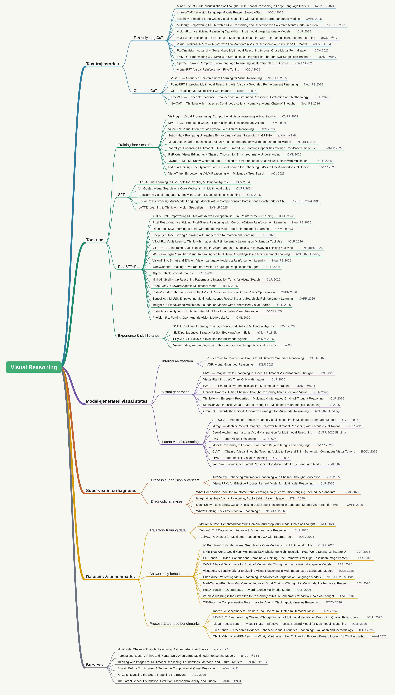

# Awesome Visual Reasoning

A curated list of visual reasoning papers with multi-step reasoning trajectories.

## Contents

- [Taxonomy](#taxonomy)
- [Text Trajectories](#text-trajectories)
- [Tool Use](#tool-use)
- [Model-generated Visual States](#model-generated-visual-states)
- [Supervision & Diagnosis](#supervision--diagnosis)
- [Datasets & Benchmarks](#datasets--benchmarks)
- [Surveys](#surveys)

## Taxonomy

## Text Trajectories

### Text-only Long CoT

| Paper | Date | Venue | Training | Code |
| --- | --- | --- | --- | --- |
| [Do MLLMs Really See It: Reinforcing Visual Attention in Multimodal LLMs](https://arxiv.org/abs/2602.08241) | 2026-02 | arXiv | RL | — |
| [Vision-R1: Incentivizing Reasoning Capability in Multimodal Large Language Models](https://arxiv.org/abs/2503.06749) | 2025-03 | ICLR 2026 | SFT+RL | [GitHub](https://github.com/Osilly/Vision-R1)  |
| [MM-Eureka: Exploring the Frontiers of Multimodal Reasoning with Rule-based Reinforcement Learning](https://arxiv.org/abs/2503.07365) | 2025-03 | arXiv | RL | [GitHub](https://github.com/ModalMinds/MM-EUREKA)  |
| [R1-Zero's "Aha Moment" in Visual Reasoning on a 2B Non-SFT Model](https://arxiv.org/abs/2503.05132) | 2025-03 | arXiv | RL | [GitHub](https://github.com/turningpoint-ai/VisualThinker-R1-Zero)  |
| [R1-Onevision: Advancing Generalized Multimodal Reasoning through Cross-Modal Formalization](https://arxiv.org/abs/2503.10615) | 2025-03 | ICCV 2025 | SFT+RL | [GitHub](https://github.com/Fancy-MLLM/R1-onevision)  |
| [LMM-R1: Empowering 3B LMMs with Strong Reasoning Abilities Through Two-Stage Rule-Based RL](https://arxiv.org/abs/2503.07536) | 2025-03 | arXiv | RL | [GitHub](https://github.com/TideDra/lmm-r1)  |
| [OpenVLThinker: Complex Vision-Language Reasoning via Iterative SFT-RL Cycles](https://arxiv.org/abs/2503.17352) | 2025-03 | NeurIPS 2025 | SFT+RL | [GitHub](https://github.com/yihedeng9/OpenVLThinker)  |
| [Visual-RFT: Visual Reinforcement Fine-Tuning](https://arxiv.org/abs/2503.01785) | 2025-03 | ICCV 2025 | RL | [GitHub](https://github.com/Liuziyu77/Visual-RFT)  |
| [Mulberry: Empowering MLLM with o1-like Reasoning and Reflection via Collective Monte Carlo Tree Search](https://arxiv.org/abs/2412.18319) | 2024-12 | NeurIPS 2025 | SFT | [GitHub](https://github.com/HJYao00/Mulberry)  |
| [LLaVA-CoT: Let Vision Language Models Reason Step-by-Step](https://arxiv.org/abs/2411.10440) | 2024-11 | ICCV 2025 | SFT | [GitHub](https://github.com/PKU-YuanGroup/LLaVA-CoT)  |
| [Insight-V: Exploring Long-Chain Visual Reasoning with Multimodal Large Language Models](https://arxiv.org/abs/2411.14432) | 2024-11 | CVPR 2025 | SFT+DPO | [GitHub](https://github.com/dongyh20/Insight-V)  |
| [Mind's Eye of LLMs: Visualization-of-Thought Elicits Spatial Reasoning in Large Language Models](https://arxiv.org/abs/2404.03622) | 2024-04 | NeurIPS 2024 | Training-free | [GitHub](https://github.com/microsoft/visualization-of-thought)  |

### Grounded CoT

| Paper | Date | Venue | Training | Code |
| --- | --- | --- | --- | --- |
| [Thinking with Images as Continuous Actions: Numerical Visual Chain-of-Thought](https://arxiv.org/abs/2602.23959) | 2026-02 | NeurIPS 2026 | SFT+RL | [GitHub](https://github.com/kesenzhao/NV-CoT)  |
| [Traceable Evidence Enhanced Visual Grounded Reasoning: Evaluation and Methodology](https://arxiv.org/abs/2507.07999) | 2025-07 | ICLR 2026 | RL | [GitHub](https://github.com/Haochen-Wang409/TreeVGR)  |
| [Grounded Reinforcement Learning for Visual Reasoning](https://arxiv.org/abs/2505.23678) | 2025-05 | NeurIPS 2025 | SFT+RL | [GitHub](https://github.com/Gabesarch/grounded-rl)  |
| [Point-RFT: Improving Multimodal Reasoning with Visually Grounded Reinforcement Finetuning](https://arxiv.org/abs/2505.19702) | 2025-05 | NeurIPS 2025 | SFT+RL | — |
| [GRIT: Teaching MLLMs to Think with Images](https://arxiv.org/abs/2505.15879) | 2025-05 | NeurIPS 2025 | RL | [GitHub](https://github.com/eric-ai-lab/GRIT)  |

## Tool Use

### Experience & Agent Skill

| Paper | Date | Venue | Training | Code |
| --- | --- | --- | --- | --- |
| [VisualCoding: Learning Executable Skills for Reliable Visual Reasoning](https://arxiv.org/abs/2610.14403) | 2026-10 | arXiv | Non-parametric | [GitHub](https://github.com/jiaq-liu/VisualCoding)  |
| [ViSkill: Reinforcing VLM Agents with Evolving Visual-Native Skills](https://arxiv.org/abs/2610.12403) | 2026-10 | arXiv | Non-parametric + RL | [GitHub](https://github.com/ZJU-REAL/ViSkill)  |
| [EvolvingBrain: An Adaptive Skill System for Multi-modal Agents Self-Evolution in Open Worlds](https://arxiv.org/abs/2610.20786) | 2026-10 | arXiv | Non-parametric | — |
| [Self-Evolving Code-with-Image Reasoning](https://arxiv.org/abs/2608.11292) | 2026-08 | arXiv | Non-parametric | — |
| [SPyCE: Skill-Policy Co-evolution for Multimodal Agents](https://arxiv.org/abs/2607.13854) | 2026-07 | ACM MM 2026 | Non-parametric + SFT+RL | — |
| [SkillOpt: Executive Strategy for Self-Evolving Agent Skills](https://arxiv.org/abs/2605.23904) | 2026-05 | arXiv | Non-parametric | [GitHub](https://github.com/microsoft/SkillOpt)  |
| [XSkill: Continual Learning from Experience and Skills in Multimodal Agents](https://arxiv.org/abs/2603.12056) | 2026-03 | ICML 2026 | Non-parametric | [GitHub](https://github.com/XSkill-Agent/XSkill)  |
| [Training-Free Group Relative Policy Optimization](https://arxiv.org/abs/2510.08191) | 2025-10 | arXiv | Non-parametric | [GitHub](https://github.com/TencentCloudADP/youtu-agent)  |

### Training-free / Test-time

| Paper | Date | Venue | Training | Code |
| --- | --- | --- | --- | --- |
| [PyVision: Agentic Vision with Dynamic Tooling](https://arxiv.org/abs/2507.07998) | 2025-07 | NeurIPS 2025 Workshop | Training-free | [GitHub](https://github.com/agents-x-project/PyVision)  |
| [Thinking with Visual Abstract: Enhancing Multimodal Reasoning via Visual Abstraction](https://arxiv.org/abs/2505.20164) | 2025-05 | NeurIPS 2025 Workshop | Training-free | [GitHub](https://github.com/THUNLP-MT/VAT)  |
| [DyFo: A Training-Free Dynamic Focus Visual Search for Enhancing LMMs in Fine-Grained Visual Understanding](https://arxiv.org/abs/2504.14920) | 2025-04 | CVPR 2025 | Test-time adaptation | [GitHub](https://github.com/PKU-ICST-MIPL/DyFo_CVPR2025)  |
| [VisuoThink: Empowering LVLM Reasoning with Multimodal Tree Search](https://arxiv.org/abs/2504.09130) | 2025-04 | ACL 2025 | Test-time adaptation | [GitHub](https://github.com/ekonwang/VisuoThink)  |
| [MLLMs Know Where to Look: Training-free Perception of Small Visual Details with Multimodal LLMs](https://arxiv.org/abs/2502.17422) | 2025-02 | ICLR 2025 | Training-free | [GitHub](https://github.com/saccharomycetes/mllms_know)  |
| [ReFocus: Visual Editing as a Chain of Thought for Structured Image Understanding](https://arxiv.org/abs/2501.05452) | 2025-01 | ICML 2025 | Training-free | [GitHub](https://github.com/zeyofu/ReFocus_Code)  |
| [ZoomEye: Enhancing Multimodal LLMs with Human-Like Zooming Capabilities through Tree-Based Image Exploration](https://arxiv.org/abs/2411.16044) | 2024-11 | EMNLP 2025 | Test-time adaptation | [GitHub](https://github.com/om-ai-lab/ZoomEye)  |
| [Visual Sketchpad: Sketching as a Visual Chain of Thought for Multimodal Language Models](https://arxiv.org/abs/2406.09403) | 2024-06 | NeurIPS 2024 | Training-free | [GitHub](https://github.com/Yushi-Hu/VisualSketchpad)  |
| [Set-of-Mark Prompting Unleashes Extraordinary Visual Grounding in GPT-4V](https://arxiv.org/abs/2310.11441) | 2023-10 | arXiv | Training-free | [GitHub](https://github.com/microsoft/SoM)  |
| [MM-REACT: Prompting ChatGPT for Multimodal Reasoning and Action](https://arxiv.org/abs/2303.11381) | 2023-03 | arXiv | Training-free | [GitHub](https://github.com/microsoft/MM-REACT)  |
| [ViperGPT: Visual Inference via Python Execution for Reasoning](https://arxiv.org/abs/2303.08128) | 2023-03 | ICCV 2023 | Training-free | [GitHub](https://github.com/cvlab-columbia/viper)  |
| [Visual Programming: Compositional visual reasoning without training](https://arxiv.org/abs/2211.11559) | 2022-11 | CVPR 2023 | Training-free | [GitHub](https://github.com/allenai/visprog)  |

### SFT

| Paper | Date | Venue | Training | Code |
| --- | --- | --- | --- | --- |
| [Bridging Modality Disconnect in Self-Reflection via Closed-Loop Visually Grounded Verification](https://arxiv.org/abs/2602.18746) | 2026-02 | arXiv | SFT | — |
| [Simple o3: Towards Interleaved Vision-Language Reasoning](https://arxiv.org/abs/2508.12109) | 2025-08 | arXiv | SFT | — |
| [LATTE: Learning to Think with Vision Specialists](https://arxiv.org/abs/2412.05479) | 2024-12 | EMNLP 2025 | SFT | [GitHub](https://github.com/SalesforceAIResearch/LATTE)  |
| [Visual CoT: Advancing Multi-Modal Language Models with a Comprehensive Dataset and Benchmark for Chain-of-Thought Reasoning](https://arxiv.org/abs/2403.16999) | 2024-03 | NeurIPS 2024 D&B | SFT | [GitHub](https://github.com/deepcs233/Visual-CoT)  |
| [Chain-of-Spot: Interactive Reasoning Improves Large Vision-Language Models](https://arxiv.org/abs/2403.12966) | 2024-03 | arXiv | SFT | [GitHub](https://github.com/dongyh20/Chain-of-Spot)  |
| [CogCoM: A Visual Language Model with Chain-of-Manipulations Reasoning](https://arxiv.org/abs/2402.04236) | 2024-02 | ICLR 2025 | SFT | [GitHub](https://github.com/THUDM/CogCoM)  |
| [V\*: Guided Visual Search as a Core Mechanism in Multimodal LLMs](https://arxiv.org/abs/2312.14135) | 2023-12 | CVPR 2024 | SFT | [GitHub](https://github.com/penghao-wu/vstar)  |
| [LLaVA-Plus: Learning to Use Tools for Creating Multimodal Agents](https://arxiv.org/abs/2311.05437) | 2023-11 | ECCV 2024 | SFT | [GitHub](https://github.com/LLaVA-VL/LLaVA-Plus-Codebase)  |

### RL / SFT+RL

| Paper | Date | Venue | Training | Code |
| --- | --- | --- | --- | --- |
| [Beacon: Knowing When and How to Perform Agentic Visual Reasoning](https://arxiv.org/abs/2607.28595) | 2026-07 | arXiv | RL | [GitHub](https://github.com/NOVAglow646/Beacon)  |
| [Walk the Talk: Bridging the Reasoning-Action Gap for Thinking with Images via Multimodal Agentic Policy Optimization](https://arxiv.org/abs/2604.06777) | 2026-04 | arXiv | SFT+RL | — |
| [HART: High-Resolution Annotation-Free Reasoning Technique through a Closed-loop Framework](https://arxiv.org/abs/2602.23615) | 2026-02 | arXiv | RL+SFT | — |
| [PyVision-RL: Forging Open Agentic Vision Models via RL](https://arxiv.org/abs/2602.20739) | 2026-02 | ICML 2026 | SFT+RL | [GitHub](https://github.com/agents-x-project/PyVision-RL)  |
| [SenseNova-MARS: Empowering Multimodal Agentic Reasoning and Search via Reinforcement Learning](https://arxiv.org/abs/2512.24330) | 2025-12 | CVPR 2026 | SFT+RL | [GitHub](https://github.com/OpenSenseNova/SenseNova-MARS)  |
| [InSight-o3: Empowering Multimodal Foundation Models with Generalized Visual Search](https://arxiv.org/abs/2512.18745) | 2025-12 | ICLR 2026 | RL | [GitHub](https://github.com/m-Just/InSight-o3)  |
| [Thinking with Images via Self-Calling Agent](https://arxiv.org/abs/2512.08511) | 2025-12 | arXiv | RL | [GitHub](https://github.com/YWenxi/think-with-images-through-self-calling)  |
| [CodeDance: A Dynamic Tool-integrated MLLM for Executable Visual Reasoning](https://arxiv.org/abs/2512.17312) | 2025-12 | CVPR 2026 | SFT+RL | [GitHub](https://github.com/CodeDance-VL/CodeDance)  |
| [DeepEyesV2: Toward Agentic Multimodal Model](https://arxiv.org/abs/2511.05271) | 2025-11 | ICLR 2026 | SFT+RL | [GitHub](https://github.com/Visual-Agent/DeepEyesV2)  |
| [CodeV: Code with Images for Faithful Visual Reasoning via Tool-Aware Policy Optimization](https://arxiv.org/abs/2511.19661) | 2025-11 | CVPR 2026 | SFT+RL | [GitHub](https://github.com/RenlyH/CodeV)  |
| [Mini-o3: Scaling Up Reasoning Patterns and Interaction Turns for Visual Search](https://arxiv.org/abs/2509.07969) | 2025-09 | ICLR 2026 | SFT+RL | [GitHub](https://github.com/Mini-o3/Mini-o3)  |
| [Reinforced Visual Perception with Tools](https://arxiv.org/abs/2509.01656) | 2025-09 | arXiv | SFT+RL | [GitHub](https://github.com/ls-kelvin/REVPT)  |
| [WebWatcher: Breaking New Frontier of Vision-Language Deep Research Agent](https://arxiv.org/abs/2508.05748) | 2025-08 | ICLR 2026 | SFT+RL | [GitHub](https://github.com/Alibaba-NLP/DeepResearch)  |
| [Thyme: Think Beyond Images](https://arxiv.org/abs/2508.11630) | 2025-08 | ICLR 2026 | SFT+RL | [GitHub](https://github.com/yfzhang114/Thyme)  |
| [High-Resolution Visual Reasoning via Multi-Turn Grounding-Based Reinforcement Learning](https://arxiv.org/abs/2507.05920) | 2025-07 | ACL 2026 Findings | RL | [GitHub](https://github.com/EvolvingLMMs-Lab/MGPO)  |
| [VisionThink: Smart and Efficient Vision Language Model via Reinforcement Learning](https://arxiv.org/abs/2507.13348) | 2025-07 | NeurIPS 2025 | RL | [GitHub](https://github.com/dvlab-research/VisionThink)  |
| [Reinforcing Spatial Reasoning in Vision-Language Models with Interwoven Thinking and Visual Drawing](https://arxiv.org/abs/2506.09965) | 2025-06 | NeurIPS 2025 | SFT+RL | [GitHub](https://github.com/AntResearchNLP/ViLaSR)  |
| [ACTIVE-o3: Empowering MLLMs with Active Perception via Pure Reinforcement Learning](https://arxiv.org/abs/2505.21457) | 2025-05 | ICML 2026 | RL | [GitHub](https://github.com/aim-uofa/Active-o3)  |
| [Ground-R1: Incentivizing Grounded Visual Reasoning via Reinforcement Learning](https://arxiv.org/abs/2505.20272) | 2025-05 | arXiv | RL | [GitHub](https://github.com/zzzhhzzz/Ground-R1)  |
| [Pixel Reasoner: Incentivizing Pixel-Space Reasoning with Curiosity-Driven Reinforcement Learning](https://arxiv.org/abs/2505.15966) | 2025-05 | NeurIPS 2025 | SFT+RL | [GitHub](https://github.com/TIGER-AI-Lab/Pixel-Reasoner)  |
| [Adaptive Chain-of-Focus Reasoning via Dynamic Visual Search and Zooming for Efficient VLMs](https://arxiv.org/abs/2505.15436) | 2025-05 | arXiv | SFT+RL | [GitHub](https://github.com/xtong-zhang/Chain-of-Focus)  |
| [OpenThinkIMG: Learning to Think with Images via Visual Tool Reinforcement Learning](https://arxiv.org/abs/2505.08617) | 2025-05 | arXiv | SFT+RL | [GitHub](https://github.com/zhaochen0110/OpenThinkIMG)  |
| [DeepEyes: Incentivizing "Thinking with Images" via Reinforcement Learning](https://arxiv.org/abs/2505.14362) | 2025-05 | ICLR 2026 | RL | [GitHub](https://github.com/Visual-Agent/DeepEyes)  |
| [VTool-R1: VLMs Learn to Think with Images via Reinforcement Learning on Multimodal Tool Use](https://arxiv.org/abs/2505.19255) | 2025-05 | ICLR 2026 | RL | [GitHub](https://github.com/VTOOL-R1/vtool-r1)  |
| [Visual Agentic Reinforcement Fine-Tuning](https://arxiv.org/abs/2505.14246) | 2025-05 | arXiv | RL | [GitHub](https://github.com/Liuziyu77/Visual-RFT)  |

## Model-generated Visual States

### Internal Re-attention

| Paper | Date | Venue | Training | Code |
| --- | --- | --- | --- | --- |
| [VGR: Visual Grounded Reasoning](https://arxiv.org/abs/2506.11991) | 2025-06 | ICLR 2026 | SFT | — |
| [v1: Learning to Point Visual Tokens for Multimodal Grounded Reasoning](https://arxiv.org/abs/2505.18842) | 2025-05 | COLM 2026 | SFT | [GitHub](https://github.com/jun297/v1)  |

### Visual Generation

| Paper | Date | Venue | Training | Code |
| --- | --- | --- | --- | --- |
| [Bridging Interleaved Multi-Modal Reasoning as a Unified Decision Process](https://arxiv.org/abs/2607.03748) | 2026-07 | arXiv | RL | [GitHub](https://github.com/NJU-RL/BRAID)  (code pending) |
| [Omni-R1: Towards the Unified Generative Paradigm for Multimodal Reasoning](https://arxiv.org/abs/2601.09536) | 2026-01 | ACL 2026 Findings | SFT+RL | [GitHub](https://github.com/ModalityDance/Omni-R1)  |
| [ThinkMorph: Emergent Properties in Multimodal Interleaved Chain-of-Thought Reasoning](https://arxiv.org/abs/2510.27492) | 2025-10 | ICLR 2026 | SFT | [GitHub](https://github.com/ThinkMorph/ThinkMorph)  |
| [MathCanvas: Intrinsic Visual Chain-of-Thought for Multimodal Mathematical Reasoning](https://arxiv.org/abs/2510.14958) | 2025-10 | ACL 2026 | Pretraining+SFT | [GitHub](https://github.com/shiwk24/MathCanvas)  |
| [Uni-cot: Towards Unified Chain-of-Thought Reasoning Across Text and Vision](https://arxiv.org/abs/2508.05606) | 2025-08 | ICLR 2026 | Not stated | [GitHub](https://github.com/Fr0zenCrane/UniCoT)  |
| [Thinking with Generated Images](https://arxiv.org/abs/2505.22525) | 2025-05 | arXiv | Not stated | [GitHub](https://github.com/GAIR-NLP/thinking-with-generated-images)  |
| [Visual Planning: Let's Think Only with Images](https://arxiv.org/abs/2505.11409) | 2025-05 | ICLR 2026 | RL | [GitHub](https://github.com/yix8/VisualPlanning)  |
| [Emerging Properties in Unified Multimodal Pretraining](https://arxiv.org/abs/2505.14683) | 2025-05 | arXiv | Pretraining | [GitHub](https://github.com/ByteDance-Seed/Bagel)  |
| [Imagine while Reasoning in Space: Multimodal Visualization-of-Thought](https://arxiv.org/abs/2501.07542) | 2025-01 | ICML 2025 | SFT | — |
| [Chain of Images for Intuitively Reasoning](https://arxiv.org/abs/2311.09241) | 2023-11 | arXiv | Not stated | [GitHub](https://github.com/GraphPKU/CoI)  |

### Latent Visual Reasoning

| Paper | Date | Venue | Training | Code |
| --- | --- | --- | --- | --- |
| [Rethinking Latent Visual Reasoning: Grounding Latent Reasoning in Visual Evidence](https://arxiv.org/abs/2609.34563) | 2026-09 | arXiv | RL + evidence supervision | — |
| [Retrieve, Integrate, and Synthesize: Spatial-Semantic Grounded Latent Visual Reasoning](https://arxiv.org/abs/2605.07106) | 2026-05 | arXiv | SFT | — |
| [Visual Latents Know More Than They Say: Unsilencing Latent Reasoning in MLLMs](https://arxiv.org/abs/2605.02735) | 2026-05 | arXiv | Test-time adaptation | — |
| [Decompose, Look, and Reason: Reinforced Latent Reasoning for VLMs](https://arxiv.org/abs/2604.07518) | 2026-04 | arXiv | Includes RL | — |
| [LanteRn: Latent Visual Structured Reasoning](https://arxiv.org/abs/2603.25629) | 2026-03 | ICLR 2026 Workshop | SFT+RL | — |
| [CrystaL: Spontaneous Emergence of Visual Latents in MLLMs](https://arxiv.org/abs/2602.20980) | 2026-02 | arXiv | Single-stage training | — |
| [Vision-aligned Latent Reasoning for Multi-modal Large Language Model](https://arxiv.org/abs/2602.04476) | 2026-02 | ICML 2026 | Not stated | [GitHub](https://github.com/rootyjeon/Vision-aligned-Latent-Reasoning)  (code pending) |
| [Latent Implicit Visual Reasoning](https://arxiv.org/abs/2512.21218) | 2025-12 | CVPR 2026 | SFT | — |
| [Sketch-in-Latents: Eliciting Unified Reasoning in MLLMs](https://arxiv.org/abs/2512.16584) | 2025-12 | arXiv | Not stated | [GitHub](https://github.com/TungChintao/SkiLa)  |
| [Reasoning Within the Mind: Dynamic Multimodal Interleaving in Latent Space](https://arxiv.org/abs/2512.12623) | 2025-12 | ICLR 2026 Workshop | Test-time adaptation | — |
| [Monet: Reasoning in Latent Visual Space Beyond Images and Language](https://arxiv.org/abs/2511.21395) | 2025-11 | CVPR 2026 | SFT+RL | [GitHub](https://github.com/NOVAglow646/Monet)  |
| [Chain-of-Visual-Thought: Teaching VLMs to See and Think Better with Continuous Visual Tokens](https://arxiv.org/abs/2511.19418) | 2025-11 | ECCV 2026 | SFT | [GitHub](https://github.com/Wakals/CoVT)  |
| [Latent Sketchpad: Sketching Visual Thoughts to Elicit Multimodal Reasoning in MLLMs](https://arxiv.org/abs/2510.24514) | 2025-10 | arXiv | Not stated | [GitHub](https://github.com/hwanyu112/Latent-Sketchpad)  |
| [DeepSketcher: Internalizing Visual Manipulation for Multimodal Reasoning](https://arxiv.org/abs/2509.25866) | 2025-09 | CVPR 2026 Findings | Not stated | [GitHub](https://github.com/MiliLab/DeepSketcher)  |
| [Latent Visual Reasoning](https://arxiv.org/abs/2509.24251) | 2025-09 | ICLR 2026 | SFT+RL | [GitHub](https://github.com/VincentLeebang/lvr)  |
| [Multimodal Chain of Continuous Thought for Latent-Space Reasoning in Vision-Language Models](https://arxiv.org/abs/2508.12587) | 2025-08 | NeurIPS 2025 Workshop | Not stated | [GitHub](https://github.com/Hanhpt23/OmniMod)  |
| [Machine Mental Imagery: Empower Multimodal Reasoning with Latent Visual Tokens](https://arxiv.org/abs/2506.17218) | 2025-06 | CVPR 2026 | SFT+RL | [GitHub](https://github.com/UMass-Embodied-AGI/Mirage)  |
| [Perception Tokens Enhance Visual Reasoning in Multimodal Language Models](https://arxiv.org/abs/2412.03548) | 2024-12 | CVPR 2025 | SFT | [GitHub](https://github.com/mahtabbigverdi/Aurora)  (code pending) |

## Supervision & Diagnosis

### Process Supervision & Verifiers

| Paper | Date | Venue | Code |
| --- | --- | --- | --- |
| [VisualPRM: An Effective Process Reward Model for Multimodal Reasoning](https://arxiv.org/abs/2503.10291) | 2025-03 | ICLR 2026 | [GitHub](https://github.com/OpenGVLab/InternVL)  |
| [MM-Verify: Enhancing Multimodal Reasoning with Chain-of-Thought Verification](https://arxiv.org/abs/2502.13383) | 2025-02 | ACL 2025 | [GitHub](https://github.com/Aurora-slz/MM-Verify)  |

### Diagnostic Analyses

| Paper | Date | Venue | Code |
| --- | --- | --- | --- |
| [Thinking With Tools, Not With Pixels: Tool Calls as Text Scaffolds for Visual Reasoning](https://arxiv.org/abs/2608.09682) | 2026-08 | arXiv | — |
| [Do Multimodal Agents Really Benefit from Tool Use? A Systematic Study of Capability Gains](https://arxiv.org/abs/2606.02357) | 2026-06 | arXiv | — |
| [What Does Vision Tool-Use Reinforcement Learning Really Learn? Disentangling Tool-Induced and Intrinsic Effects for Crop-and-Zoom](https://arxiv.org/abs/2602.01334) | 2026-02 | ICML 2026 | [GitHub](https://github.com/GAIR-NLP/Med)  |
| [VisualNeedle: Benchmarking Active Visual Search in Information-Dense Scenes](https://arxiv.org/abs/2605.26380) | 2026-05 | arXiv | [GitHub](https://github.com/visualneedle-org/VisualNeedle)  |
| [Don't Show Pixels, Show Cues: Unlocking Visual Tool Reasoning in Language Models via Perception Programs](https://arxiv.org/abs/2604.12896) | 2026-04 | CVPR 2026 | [GitHub](https://github.com/AISmartPerception/perception-programs)  |
| [See2Think: Do Multimodal Models Really Use Intermediate Visual States?](https://arxiv.org/abs/2607.26769) | 2026-07 | arXiv | [GitHub](https://github.com/CSU-JPG/See2Think)  |
| [Imagination Helps Visual Reasoning, But Not Yet in Latent Space](https://arxiv.org/abs/2602.22766) | 2026-02 | ICML 2026 | [GitHub](https://github.com/AI9Stars/CapImagine)  (code pending) |
| [What's Holding Back Latent Visual Reasoning?](https://arxiv.org/abs/2605.18445) | 2026-05 | NeurIPS 2026 | — |
| [Beyond Visual Memory: Mechanistic Diagnostics of Latent Visual Reasoning](https://arxiv.org/abs/2606.01287) | 2026-05 | arXiv | — |

## Datasets & Benchmarks

### Trajectory Training Data

| Name / Paper | Date | Venue | Scale | Code |
| --- | --- | --- | --- | --- |
| V-Interaction-400K (V-Thinker) [V-Thinker: Interactive Thinking with Images](https://arxiv.org/abs/2511.04460) | 2025-11 | arXiv | 400K (≈253K public) | [GitHub](https://github.com/We-Math/V-Thinker)  |
| DeepEyesV2 [DeepEyesV2: Toward Agentic Multimodal Model](https://arxiv.org/abs/2511.05271) | 2025-11 | ICLR 2026 | — | [GitHub](https://github.com/Visual-Agent/DeepEyesV2)  |
| ThinkMorph [ThinkMorph: Emergent Properties in Multimodal Interleaved Chain-of-Thought Reasoning](https://arxiv.org/abs/2510.27492) | 2025-10 | ICLR 2026 | 24,990 | [GitHub](https://github.com/ThinkMorph/ThinkMorph)  |
| MathCanvas [MathCanvas: Intrinsic Visual Chain-of-Thought for Multimodal Mathematical Reasoning](https://arxiv.org/abs/2510.14958) | 2025-10 | ACL 2026 | 15.2M pretrain + 219K | [GitHub](https://github.com/shiwk24/MathCanvas)  |
| Visual Probe (Mini-o3) [Mini-o3: Scaling Up Reasoning Patterns and Interaction Turns for Visual Search](https://arxiv.org/abs/2509.07969) | 2025-09 | ICLR 2026 | Thousands | [GitHub](https://github.com/Mini-o3/Mini-o3)  |
| Thyme [Thyme: Think Beyond Images](https://arxiv.org/abs/2508.11630) | 2025-08 | ICLR 2026 | 500K (SFT) | [GitHub](https://github.com/yfzhang114/Thyme)  |
| TWI-Tools-146K (Simple o3) [Simple o3: Towards Interleaved Vision-Language Reasoning](https://arxiv.org/abs/2508.12109) | 2025-08 | arXiv | 146K | — |
| ToolVQA [ToolVQA: A Dataset for Multi-step Reasoning VQA with External Tools](https://arxiv.org/abs/2508.03284) | 2025-08 | ICCV 2025 | 23K | [GitHub](https://github.com/Fugtemypt123/ToolVQA-release)  |
| Zebra-CoT [Zebra-CoT: A Dataset for Interleaved Vision Language Reasoning](https://arxiv.org/abs/2507.16746) | 2025-07 | ICLR 2026 | 182,384 | [GitHub](https://github.com/multimodal-reasoning-lab/Bagel-Zebra-CoT)  |
| TreeVGR-SFT / RL [Traceable Evidence Enhanced Visual Grounded Reasoning: Evaluation and Methodology](https://arxiv.org/abs/2507.07999) | 2025-07 | ICLR 2026 | 35K SFT + 37K RL | [GitHub](https://github.com/Haochen-Wang409/TreeVGR)  |
| VGR-SFT [VGR: Visual Grounded Reasoning](https://arxiv.org/abs/2506.11991) | 2025-06 | ICLR 2026 | 158K | — |
| MM-CoF (Chain-of-Focus) [Adaptive Chain-of-Focus Reasoning via Dynamic Visual Search and Zooming for Efficient VLMs](https://arxiv.org/abs/2505.15436) | 2025-05 | arXiv | 3K–5K | [GitHub](https://github.com/xtong-zhang/Chain-of-Focus)  |
| Pixel Reasoner [Pixel Reasoner: Incentivizing Pixel-Space Reasoning with Curiosity-Driven Reinforcement Learning](https://arxiv.org/abs/2505.15966) | 2025-05 | NeurIPS 2025 | 7.5K (SFT) | [GitHub](https://github.com/TIGER-AI-Lab/Pixel-Reasoner)  |
| DeepEyes [DeepEyes: Incentivizing "Thinking with Images" via Reinforcement Learning](https://arxiv.org/abs/2505.14362) | 2025-05 | ICLR 2026 | 47K queries | [GitHub](https://github.com/Visual-Agent/DeepEyes)  |
| Visual-ARFT / MAT [Visual Agentic Reinforcement Fine-Tuning](https://arxiv.org/abs/2505.14246) | 2025-05 | arXiv | ≈1.2K | [GitHub](https://github.com/Liuziyu77/Visual-RFT)  |
| R1-Onevision [R1-Onevision: Advancing Generalized Multimodal Reasoning through Cross-Modal Formalization](https://arxiv.org/abs/2503.10615) | 2025-03 | ICCV 2025 | >155K | [GitHub](https://github.com/Fancy-MLLM/R1-onevision)  |
| VisualPRM400K [VisualPRM: An Effective Process Reward Model for Multimodal Reasoning](https://arxiv.org/abs/2503.10291) | 2025-03 | ICLR 2026 | ≈400K | [GitHub](https://github.com/OpenGVLab/InternVL)  |
| Mulberry-260k [Mulberry: Empowering MLLM with o1-like Reasoning and Reflection via Collective Monte Carlo Tree Search](https://arxiv.org/abs/2412.18319) | 2024-12 | NeurIPS 2025 | 260K | [GitHub](https://github.com/HJYao00/Mulberry)  |
| LATTE-trace (formerly TACO) [LATTE: Learning to Think with Vision Specialists](https://arxiv.org/abs/2412.05479) | 2024-12 | EMNLP 2025 | 293K | [GitHub](https://github.com/SalesforceAIResearch/LATTE)  |
| LLaVA-CoT-100k [LLaVA-CoT: Let Vision Language Models Reason Step-by-Step](https://arxiv.org/abs/2411.10440) | 2024-11 | ICCV 2025 | ≈99K | [GitHub](https://github.com/PKU-YuanGroup/LLaVA-CoT)  |
| M3CoT [M³CoT: A Novel Benchmark for Multi-Domain Multi-step Multi-modal Chain-of-Thought](https://arxiv.org/abs/2405.16473) | 2024-05 | ACL 2024 | 11,459 | [GitHub](https://github.com/LightChen233/M3CoT)  |
| Visual CoT [Visual CoT: Advancing Multi-Modal Language Models with a Comprehensive Dataset and Benchmark for Chain-of-Thought Reasoning](https://arxiv.org/abs/2403.16999) | 2024-03 | NeurIPS 2024 D&B | 438K | [GitHub](https://github.com/deepcs233/Visual-CoT)  |
| CogCoM [CogCoM: A Visual Language Model with Chain-of-Manipulations Reasoning](https://arxiv.org/abs/2402.04236) | 2024-02 | ICLR 2025 | 70K + 6K | [GitHub](https://github.com/THUDM/CogCoM)  |

### Answer-only Benchmarks

| Name / Paper | Date | Venue | Scale | Code |
| --- | --- | --- | --- | --- |
| AgentVista [AgentVista: Evaluating Multimodal Agents in Ultra-Challenging Realistic Visual Scenarios](https://arxiv.org/abs/2602.23166) | 2026-02 | arXiv | 209 tasks | [GitHub](https://github.com/hkust-nlp/AgentVista)  |
| RealX-Bench [DeepEyesV2: Toward Agentic Multimodal Model](https://arxiv.org/abs/2511.05271) | 2025-11 | ICLR 2026 | 300 | [GitHub](https://github.com/Visual-Agent/DeepEyesV2)  |
| MIRA [When Visualizing is the First Step to Reasoning: MIRA, a Benchmark for Visual Chain-of-Thought](https://arxiv.org/abs/2511.02779) | 2025-11 | CVPR 2026 | 546 | — |
| TIR-Bench [TIR-Bench: A Comprehensive Benchmark for Agentic Thinking-with-Images Reasoning](https://arxiv.org/abs/2511.01833) | 2025-11 | ECCV 2026 | 1,215 | [GitHub](https://github.com/agents-x-project/TIR-Bench)  |
| VisualToolBench [Beyond Seeing: Evaluating Multimodal LLMs on Tool-Enabled Image Perception, Transformation, and Reasoning](https://arxiv.org/abs/2510.12712) | 2025-10 | ICLR 2026 Workshop | 1,204 | — |
| MathCanvas-Bench [MathCanvas: Intrinsic Visual Chain-of-Thought for Multimodal Mathematical Reasoning](https://arxiv.org/abs/2510.14958) | 2025-10 | ACL 2026 | 3K | [GitHub](https://github.com/shiwk24/MathCanvas)  |
| MAT [Visual Agentic Reinforcement Fine-Tuning](https://arxiv.org/abs/2505.14246) | 2025-05 | arXiv | 350 | [GitHub](https://github.com/Liuziyu77/Visual-RFT)  |
| ChartMuseum [ChartMuseum: Testing Visual Reasoning Capabilities of Large Vision-Language Models](https://arxiv.org/abs/2505.13444) | 2025-05 | NeurIPS 2025 D&B | 1,162 | [GitHub](https://github.com/Liyan06/ChartMuseum)  |
| VisuLogic [VisuLogic: A Benchmark for Evaluating Visual Reasoning in Multi-modal Large Language Models](https://arxiv.org/abs/2504.15279) | 2025-04 | ICLR 2026 | 1,000 | [GitHub](https://github.com/VisuLogic-Benchmark/VisuLogic-Eval)  |
| VisFactor [Human Cognitive Benchmarks Reveal Foundational Visual Gaps in MLLMs](https://arxiv.org/abs/2502.16435) | 2025-02 | arXiv | 20 subtests | [GitHub](https://github.com/CUHK-ARISE/VisFactor)  |
| CoMT [CoMT: A Novel Benchmark for Chain of Multi-modal Thought on Large Vision-Language Models](https://arxiv.org/abs/2412.12932) | 2024-12 | AAAI 2025 | 3,853 | [GitHub](https://github.com/czhhzc/CoMT)  |
| MME-RealWorld [MME-RealWorld: Could Your Multimodal LLM Challenge High-Resolution Real-World Scenarios that are Difficult for Humans?](https://arxiv.org/abs/2408.13257) | 2024-08 | ICLR 2025 | 29,429 | [GitHub](https://github.com/MME-Benchmarks/MME-RealWorld)  |
| HR-Bench [Divide, Conquer and Combine: A Training-Free Framework for High-Resolution Image Perception in Multimodal Large Language Models](https://arxiv.org/abs/2408.15556) | 2024-08 | AAAI 2025 | 200 (8K) | [GitHub](https://github.com/DreamMr/HR-Bench)  |
| V\* Bench [V\*: Guided Visual Search as a Core Mechanism in Multimodal LLMs](https://arxiv.org/abs/2312.14135) | 2023-12 | CVPR 2024 | 191 | [GitHub](https://github.com/penghao-wu/vstar)  |

### Process & Tool-use Benchmarks

| Name / Paper | Date | Venue | Scale | Code |
| --- | --- | --- | --- | --- |
| See2ThinkBench [See2Think: Do Multimodal Models Really Use Intermediate Visual States?](https://arxiv.org/abs/2607.26769) | 2026-07 | arXiv | 1,200 | [GitHub](https://github.com/CSU-JPG/See2Think)  |
| Agentic-MME [Agentic-MME: What Agentic Capability Really Brings to Multimodal Intelligence?](https://arxiv.org/abs/2604.03016) | 2026-04 | arXiv | 418 tasks | [GitHub](https://github.com/ChoS3nE11ven/Agentic-MME)  |
| VTC-Bench [VTC-Bench: Evaluating Agentic Multimodal Models via Compositional Visual Tool Chaining](https://arxiv.org/abs/2603.15030) | 2026-03 | arXiv | 680 | [GitHub](https://github.com/zhuzil/VTC-Bench)  |
| ThinkWithImages-PRMBench [What, Whether and How? Unveiling Process Reward Models for Thinking with Images Reasoning](https://arxiv.org/abs/2602.08346) | 2026-02 | AAAI 2026 | 1,206 trajectories | — |
| AdaptMMBench [AdaptMMBench: Benchmarking Adaptive Multimodal Reasoning for Mode Selection and Reasoning Process](https://arxiv.org/abs/2602.02676) | 2026-02 | arXiv | 1,420 | — |
| VTBench [V-Thinker: Interactive Thinking with Images](https://arxiv.org/abs/2511.04460) | 2025-11 | arXiv | 1,500 | [GitHub](https://github.com/We-Math/V-Thinker)  |
| TreeBench [Traceable Evidence Enhanced Visual Grounded Reasoning: Evaluation and Methodology](https://arxiv.org/abs/2507.07999) | 2025-07 | ICLR 2026 | 405 | [GitHub](https://github.com/Haochen-Wang409/TreeVGR)  |
| ViC-Bench [ViC-Bench: Benchmarking Visual-Interleaved Chain-of-Thought Capability in MLLMs with Free-Style Intermediate State Representations](https://arxiv.org/abs/2505.14404) | 2025-05 | arXiv | 4 × 250 | — |
| VisualProcessBench [VisualPRM: An Effective Process Reward Model for Multimodal Reasoning](https://arxiv.org/abs/2503.10291) | 2025-03 | ICLR 2026 | 2,866 | [GitHub](https://github.com/OpenGVLab/InternVL)  |
| MME-CoT [MME-CoT: Benchmarking Chain-of-Thought in Large Multimodal Models for Reasoning Quality, Robustness, and Efficiency](https://arxiv.org/abs/2502.09621) | 2025-02 | ICML 2025 | 1,130 | [GitHub](https://github.com/CaraJ7/MME-CoT)  |
| m&m's [m&m's: A Benchmark to Evaluate Tool-Use for multi-step multi-modal Tasks](https://arxiv.org/abs/2403.11085) | 2024-03 | ECCV 2024 | 4K+ tasks | [GitHub](https://github.com/RAIVNLab/mnms)  |

## Surveys

| Paper | Date | Venue | Code |
| --- | --- | --- | --- |
| [Thinking with Images for Multimodal Reasoning: Foundations, Methods, and Future Frontiers](https://arxiv.org/abs/2506.23918) | 2025-06 | arXiv | [GitHub](https://github.com/zhaochen0110/Awesome_Think_With_Images)  |
| [Explain Before You Answer: A Survey on Compositional Visual Reasoning](https://arxiv.org/abs/2508.17298) | 2025-08 | arXiv | [GitHub](https://github.com/pokerme7777/Compositional-Visual-Reasoning-Survey)  |
| [A Survey on Agentic Multimodal Large Language Models](https://arxiv.org/abs/2510.10991) | 2025-10 | arXiv | [GitHub](https://github.com/HJYao00/Awesome-Agentic-MLLMs)  |
| [Mind with Eyes: from Language Reasoning to Multimodal Reasoning](https://arxiv.org/abs/2503.18071) | 2025-03 | arXiv | [GitHub](https://github.com/ADaM-BJTU/Mind_with_eyes_Awesome_MLLMs_Reasoning)  |
| [Perception, Reason, Think, and Plan: A Survey on Large Multimodal Reasoning Models](https://arxiv.org/abs/2505.04921) | 2025-05 | arXiv | [GitHub](https://github.com/HITsz-TMG/Awesome-Large-Multimodal-Reasoning-Models)  |
| [Multimodal Chain-of-Thought Reasoning: A Comprehensive Survey](https://arxiv.org/abs/2503.12605) | 2025-03 | arXiv | [GitHub](https://github.com/yaotingwangofficial/Awesome-MCoT)  |
| [The Latent Space: Foundation, Evolution, Mechanism, Ability, and Outlook](https://arxiv.org/abs/2604.02029) | 2026-04 | arXiv | [GitHub](https://github.com/YU-deep/Awesome-Latent-Space)  |
| [Revealing the Seen, Imagining the Beyond: A Survey of Image-Grounded Chain-of-Thought Reasoning in Multimodal LLMs](https://aclanthology.org/2026.acl-long.2087/) | 2026 | ACL 2026 | [GitHub](https://github.com/dddraxxx/Awesome-Image-Grounded-CoT)  |
